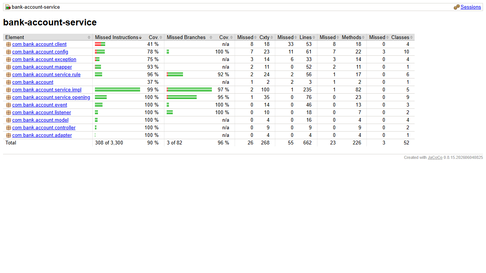

# bank-account-service

Microservicio de cuentas bancarias (productos pasivos): ahorro, corriente y
plazo fijo.

## Requisitos

- Java 17
- Maven 3.9+
- MongoDB en `localhost:27017` (base `bank_accounts`)
- `bank-config-server` (8888) y `bank-eureka-server` (8761) arriba
- `bank-customer-service` arriba en el puerto 8081

## Variables de entorno

| Variable | Por defecto | Descripcion |
|---|---|---|
| `CONFIG_SERVER_URL` | `http://localhost:8888` | URL del Config Server |

El puerto (8082), la URI de MongoDB, la URL de `customer-service` y los limites
de negocio llegan desde `bank-config-repo/bank-account-service.yml`:

```yaml
bank:
  services:
    customer-service-url: http://localhost:8081
  rules:
    current-account-maintenance-fee: 10.00
    savings-monthly-movement-limit: 20
    fixed-term-monthly-movement-limit: 1
```

## Arranque

```bash
mvn clean package
mvn spring-boot:run
```

## Endpoints

| Metodo | URL | Exito |
|---|---|---|
| POST | `/accounts` | 201 |
| GET | `/accounts` (filtro opcional `?customerId=`) | 200 |
| GET | `/accounts/{id}` | 200 |
| PUT | `/accounts/{id}` | 200 |
| DELETE | `/accounts/{id}` | 204 |
| GET | `/accounts/{id}/balance` | 200 |
| POST | `/accounts/{id}/balance-operations` | 200 |

`POST /accounts/{id}/balance-operations` es **interno**: lo llama
`bank-transaction-service`.

### Ejemplo de apertura personal

```json
{
  "accountType": "SAVINGS",
  "customerId": "68f0a1...",
  "initialBalance": 500.00
}
```

### Ejemplo de apertura empresarial

```json
{
  "accountType": "CURRENT",
  "customerId": "68f0b2...",
  "initialBalance": 1000.00,
  "holders": [
    { "documentType": "DNI", "documentNumber": "45678912", "fullName": "Ana Torres" }
  ],
  "authorizedSigners": [
    { "documentType": "DNI", "documentNumber": "10293847", "fullName": "Luis Paz" }
  ]
}
```

### Operacion de saldo (interna)

```json
{ "operation": "WITHDRAWAL", "amount": 100.00 }
```

## Reglas de negocio

**Por tipo de cuenta**

| Tipo | Comision | Movimientos |
|---|---|---|
| `SAVINGS` | sin comision | limite mensual configurable |
| `CURRENT` | con comision | sin limite |
| `FIXED_TERM` | sin comision | uno al mes, en el dia `movementDay` (1-28) |

**Por tipo de cliente** (se consulta a `customer-service`)

- `PERSONAL`: como maximo 1 cuenta de ahorro, 1 corriente y N a plazo fijo.
  El titular es el propio cliente.
- `BUSINESS`: no puede abrir ahorro ni plazo fijo; si multiples cuentas
  corrientes, con al menos un titular en `holders`.

**Otras**

- `accountNumber` se genera (14 digitos) y es unico.
- `maintenanceFee` se guarda como atributo; **no** se implementa el cobro
  automatico, el enunciado no lo pide.
- `movementDay` es obligatorio en cuentas a plazo fijo.
- El retiro se rechaza si no hay fondos suficientes.
- En `PUT`, `accountType` y `customerId` son inmutables y el saldo no se edita:
  solo cambia a traves de los movimientos.

## Codigos de error

| Caso | Codigo |
|---|---|
| Validacion de entrada | 400 |
| Cuenta o cliente inexistente | 404 |
| Regla de negocio violada (segunda cuenta de ahorro, fondos insuficientes, ...) | 409 |
| `customer-service` no disponible | 503 |

## Stack

Spring Boot 3.3.13, WebFlux, MongoDB reactivo, RxJava 3 en servicios y
controladores (`ReactorRxAdapter` en el borde con el repositorio), WebClient hacia
`customer-service`, Lombok con inyeccion por constructor, Spring Cloud Config,
Logback.

---

# Parte II

## Que cambio

- **Campos nuevos** en `Account`: `profile` (copiado del cliente),
  `openingAmount`, `minimumDailyAverage` (solo VIP), `freeTransactionLimit` y
  `transactionFee`. El campo `initialBalance` de la Parte I se sigue aceptando
  como alias de `openingAmount`.
- **Reglas de apertura**, en este orden:
  1. Reglas de la Parte I por tipo de cliente.
  2. Reglas del tipo de cuenta (plazo fijo exige `movementDay`).
  3. Monto de apertura >= minimo del tipo y perfil.
  4. VIP: solo ahorro y debe tener una tarjeta de credito.
  5. PYME: solo corriente (mantenimiento 0) y debe tener una tarjeta de credito.

  La tarjeta se verifica con `GET /credit-cards?customerId=` en
  `bank-credit-card-service`.
- **Saldos diarios**: coleccion `daily_balances` (unico por cuenta y fecha), con
  upsert en cada operacion de saldo y al abrir la cuenta.
- **Endpoints nuevos o modificados**:
  - `GET /accounts?accountNumber=`
  - `GET /accounts/{id}/average-daily-balance?month=YYYY-MM` →
    `{accountId, month, averageDailyBalance, minimumDailyAverage, meetsMinimum}`
    (`meetsMinimum` es `null` si la cuenta no tiene minimo). Solo informa, no penaliza.
  - `POST /accounts/{id}/balance-operations` acepta `fee` (opcional):
    deposito `balance += amount - fee`, retiro `balance -= amount + fee`.
    Bloqueado por el gateway (403).
- **Infraestructura**: Eureka (`bank-account-service`), WebClient
  `@LoadBalanced` hacia `http://bank-customer-service` y
  `http://bank-credit-card-service`, circuit breaker y timeout de 2 s
  (503 si el destino no responde).

## Configuracion de negocio

En `bank-config-repo/bank-account-service.yml`, prefijo `bank.accounts`:

```yaml
bank:
  accounts:
    defaults:
      savings:    { minimum-opening-amount: 0, free-transaction-limit: 5,  transaction-fee: 1.50, monthly-movement-limit: 20 }
      current:    { minimum-opening-amount: 0, free-transaction-limit: 10, transaction-fee: 1.50, maintenance-fee: 10.00 }
      fixed-term: { minimum-opening-amount: 0, free-transaction-limit: 1,  transaction-fee: 1.50, monthly-movement-limit: 1 }
    vip:  { minimum-opening-amount: 500, minimum-daily-average: 1000 }
    pyme: { minimum-opening-amount: 0 }
```

## Orden de arranque

`bank-config-server` → `bank-eureka-server` → `bank-customer-service` →
`bank-credit-card-service` → **este servicio**.

## Calidad

```bash
mvn clean verify    # Checkstyle + tests + reporte y meta de JaCoCo
```

- Reporte: `target/site/jacoco/index.html`. Meta: 80% de lineas en
  `service.impl` (hoy 100% y 96.9%).
- Tests destacados: `AccountOpeningChainTest` (VIP y PYME sin tarjeta, apertura
  bajo el minimo, reglas de la Parte I), `AccountRuleFactoryTest`,
  `DailyBalanceServiceImplTest` (arrastre de saldos con `Clock` fijo),
  `RemoteCallDecoratorTest` (circuito abierto, timeout, errores de negocio que no
  abren el circuito) y `AccountControllerTest` (`@WebFluxTest`).

## Patrones de diseno

| Patron | Donde |
|---|---|
| Strategy | `service/rule/AccountRule` y sus implementaciones: `SavingsAccountRule`, `CurrentAccountRule`, `FixedTermAccountRule`, `VipSavingsAccountRule`, `PymeCurrentAccountRule` |
| Factory | `service/rule/AccountRuleFactory`: elige la estrategia por tipo de cuenta y perfil |
| Chain of Responsibility | `service/opening/AccountOpeningHandler` y sus eslabones, armados en `AccountOpeningChain` |
| Builder | Lombok `@Builder` en documentos, DTOs y `AccountOpeningContext` |
| Adapter | `adapter/ReactorRxAdapter`: puente Reactor ↔ RxJava 3 |
| Decorator | `client/RemoteCallDecorator`: envuelve cada llamada WebClient con circuit breaker y time limiter |

---

# Parte III

## Que cambio

- **Eventos**: publica `ACCOUNT_UPSERTED` / `ACCOUNT_DELETED` en
  `bank.account.events`. `POST /admin/events/republish` (en el gateway
  `/admin/accounts/events/republish`).
- **Operaciones por Kafka**: consume `bank.account.operation-requests`
  (depositos y retiros pedidos por la tarjeta de debito y Yanki), los aplica con
  la misma logica de `balance-operations` **sin comision**, actualiza
  `daily_balances` y publica `ACCOUNT_OPERATION_COMPLETED` o
  `ACCOUNT_OPERATION_REJECTED` (`INSUFFICIENT_FUNDS`, `ACCOUNT_NOT_FOUND`) en
  `bank.account.operation-results`. Idempotente por `operationId`
  (`processed_operations`): si la operacion llega repetida se republica el mismo
  resultado sin volver a mover el saldo.
- **Deuda vencida**: consume `bank.debt.events` y mantiene `overdue_debts`. Nuevo
  primer eslabon de la cadena de apertura (`OverdueDebtHandler`): un cliente con
  deuda vencida no puede abrir cuentas (409). La consulta es local, sin REST.
- `GET /accounts/{id}/balance` agrega `customerId`.

## Variables de entorno nuevas

| Variable | Por defecto |
|---|---|
| `KAFKA_BOOTSTRAP_SERVERS` | `localhost:9092` |

## Calidad

81 tests. Cobertura 91.7% de lineas (99.6% en `service.impl`).


