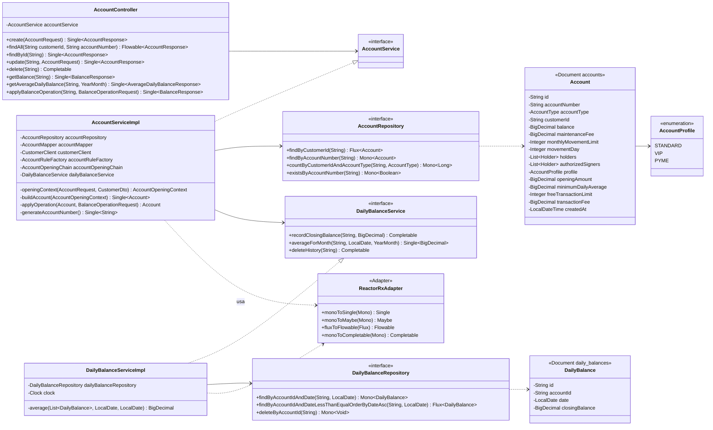
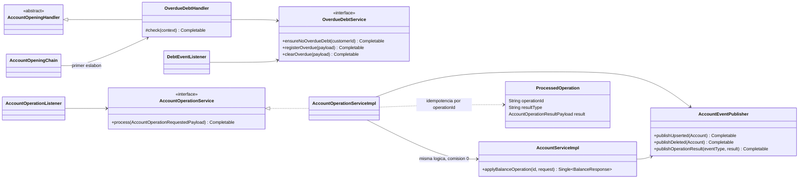

# bank-account-service — Diagramas de clases

El servicio se documenta en tres vistas para que cada diagrama siga siendo legible.

## 1. Capas principales

## 2. Patrones de apertura: Strategy, Factory y Chain of Responsibility

```mermaid
classDiagram
    direction TB

    class AccountRule {
        <<interface>>
        +minimumOpeningAmount() BigDecimal
        +validate(AccountRequest) Completable
        +applyDefaults(Account, AccountRequest) void
    }
    class SavingsAccountRule
    class CurrentAccountRule
    class FixedTermAccountRule
    class VipSavingsAccountRule {
        -SavingsAccountRule savingsAccountRule
    }
    class PymeCurrentAccountRule {
        -CurrentAccountRule currentAccountRule
    }
    class AccountRuleFactory {
        <<Factory>>
        +getRule(AccountType, AccountProfile) AccountRule
    }
    class AccountProperties {
        <<ConfigurationProperties bank.accounts>>
        -Defaults defaults
        -ProfileSettings vip
        -ProfileSettings pyme
    }

    class AccountOpeningHandler {
        <<abstract>>
        -AccountOpeningHandler next
        +linkWith(AccountOpeningHandler) AccountOpeningHandler
        +handle(AccountOpeningContext) Completable
        #check(AccountOpeningContext) Completable
    }
    class CustomerTypeRuleHandler
    class AccountTypeRuleHandler
    class OpeningAmountHandler
    class ProfileRequirementHandler {
        <<abstract>>
        -CreditCardClient creditCardClient
        -AccountProfile profile
        -AccountType allowedType
    }
    class VipProfileHandler
    class PymeProfileHandler
    class AccountOpeningChain {
        -AccountOpeningHandler first
        +validate(AccountOpeningContext) Completable
    }
    class AccountOpeningContext {
        -AccountRequest request
        -CustomerDto customer
        -AccountProfile profile
        -AccountRule rule
    }

    SavingsAccountRule ..|> AccountRule
    CurrentAccountRule ..|> AccountRule
    FixedTermAccountRule ..|> AccountRule
    VipSavingsAccountRule ..|> AccountRule
    PymeCurrentAccountRule ..|> AccountRule
    VipSavingsAccountRule --> SavingsAccountRule : delega
    PymeCurrentAccountRule --> CurrentAccountRule : delega
    AccountRuleFactory --> AccountRule : crea/elige
    SavingsAccountRule --> AccountProperties
    CurrentAccountRule --> AccountProperties
    FixedTermAccountRule --> AccountProperties

    CustomerTypeRuleHandler --|> AccountOpeningHandler
    AccountTypeRuleHandler --|> AccountOpeningHandler
    OpeningAmountHandler --|> AccountOpeningHandler
    ProfileRequirementHandler --|> AccountOpeningHandler
    VipProfileHandler --|> ProfileRequirementHandler
    PymeProfileHandler --|> ProfileRequirementHandler
    AccountOpeningHandler --> AccountOpeningHandler : next
    AccountOpeningChain --> AccountOpeningHandler : primer eslabon
    AccountOpeningContext --> AccountRule
    AccountTypeRuleHandler ..> AccountRule : validate()
    OpeningAmountHandler ..> AccountRule : minimumOpeningAmount()
```

Orden de la cadena: `CustomerTypeRuleHandler` → `AccountTypeRuleHandler` →
`OpeningAmountHandler` → `VipProfileHandler` → `PymeProfileHandler`.

## 3. Comunicacion con otros servicios (Eureka + Resilience4j)

```mermaid
classDiagram
    direction LR

    class CustomerClient {
        -WebClient customerWebClient
        -RemoteCallDecorator remoteCallDecorator
        +findById(String) Single~CustomerDto~
    }
    class CreditCardClient {
        -WebClient creditCardWebClient
        -RemoteCallDecorator remoteCallDecorator
        +hasCreditCard(String) Single~Boolean~
    }
    class RemoteCallDecorator {
        -CircuitBreakerRegistry circuitBreakerRegistry
        -TimeLimiterRegistry timeLimiterRegistry
        +decorate(String serviceName, Mono~T~ call) Mono~T~
    }
    class WebClientConfig {
        +loadBalancedWebClientBuilder() WebClient.Builder
        +customerWebClient(WebClient.Builder) WebClient
        +creditCardWebClient(WebClient.Builder) WebClient
    }
    class ServiceUrlProperties {
        <<ConfigurationProperties bank.services>>
        -String customerServiceUrl
        -String creditCardServiceUrl
    }
    class CustomerDto {
        -String id
        -CustomerType type
        -AccountProfile profile
        -DocumentType documentType
        -String documentNumber
        -String name
    }
    class ServiceUnavailableException
    class GlobalExceptionHandler

    CustomerClient --> RemoteCallDecorator
    CreditCardClient --> RemoteCallDecorator
    CustomerClient ..> CustomerDto
    WebClientConfig --> ServiceUrlProperties
    RemoteCallDecorator ..> ServiceUnavailableException : circuito abierto, timeout o conexion rechazada
    GlobalExceptionHandler ..> ServiceUnavailableException : 503
```

## Parte III: eventos, operaciones por Kafka y deuda vencida

