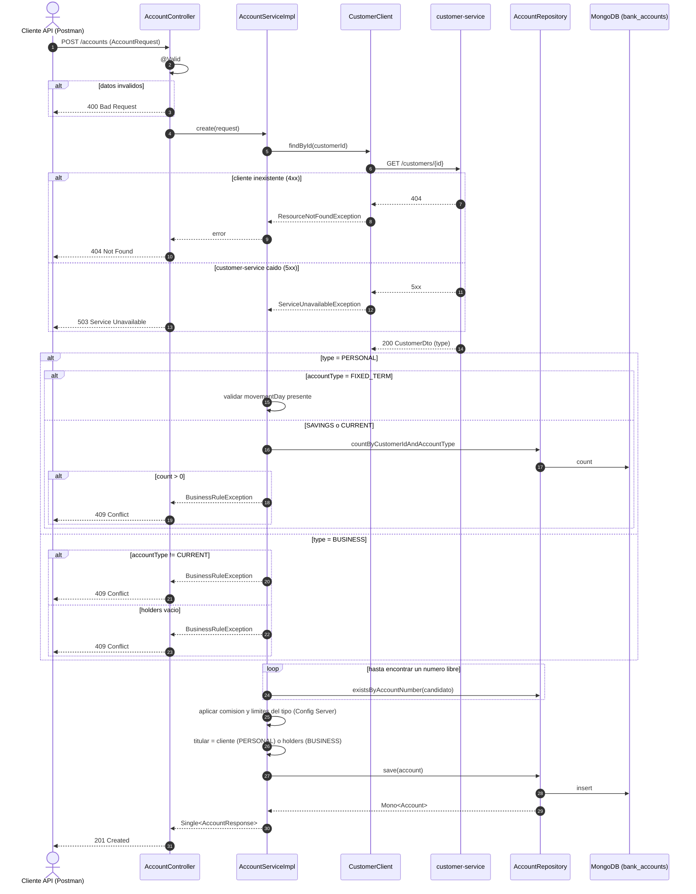
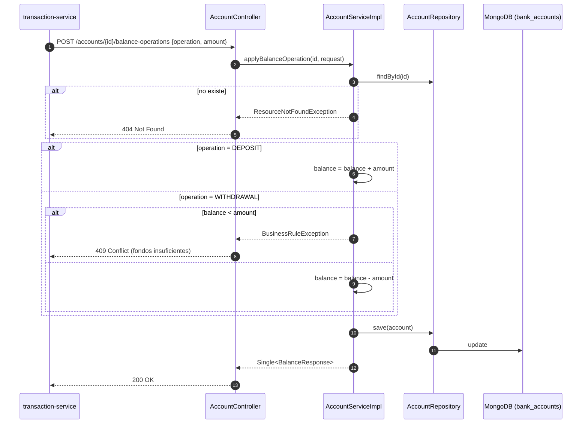
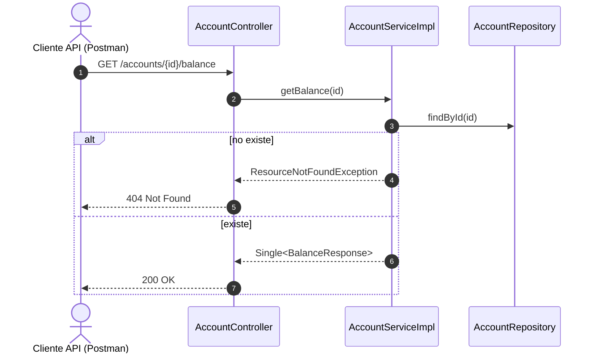
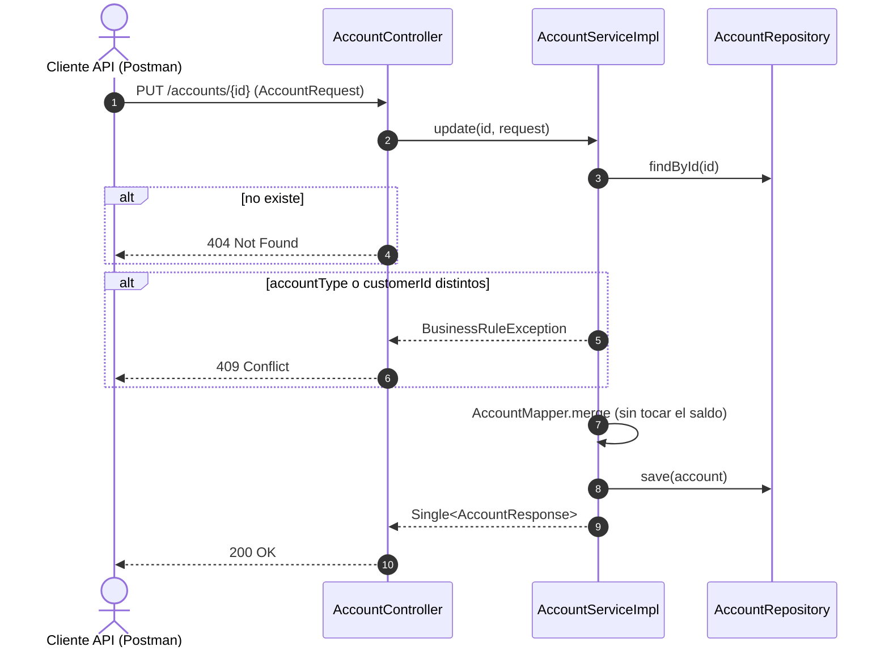
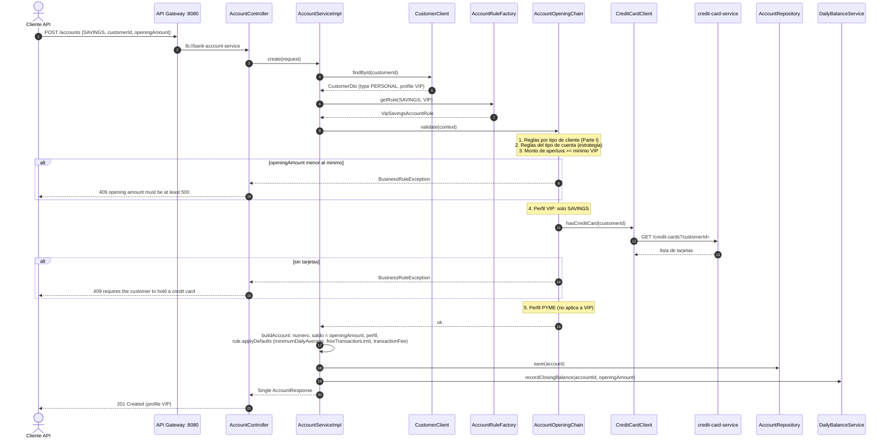
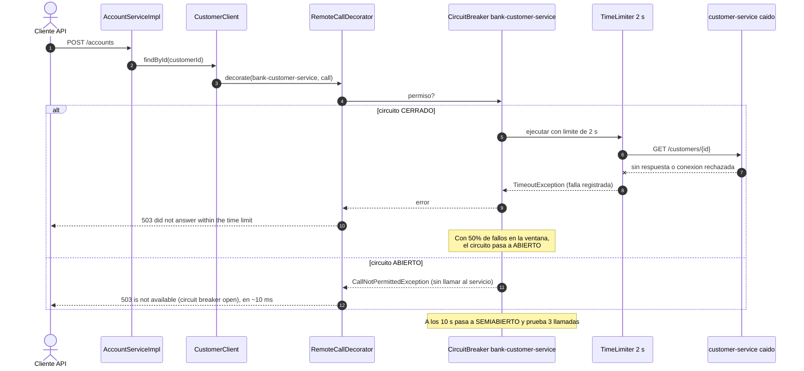
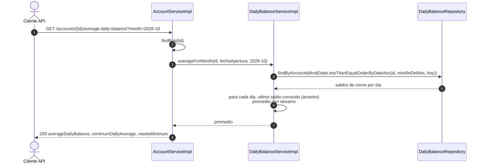

# bank-account-service — Diagramas de secuencia

## 1. Abrir una cuenta

## 2. Operacion de saldo (interna)

Invocada por `bank-transaction-service` en depositos y retiros.

## 3. Consultar saldo

## 4. Actualizar una cuenta

---

# Parte II

## 5. Apertura de cuenta VIP o PYME (Strategy + Factory + Chain of Responsibility)

Para PYME el recorrido es el mismo: la fabrica devuelve `PymeCurrentAccountRule`
(comision de mantenimiento 0) y el eslabon 5 exige `CURRENT` y una tarjeta.

## 6. Llamada con circuito abierto (Resilience4j)

## 7. Promedio diario del mes (VIP)

