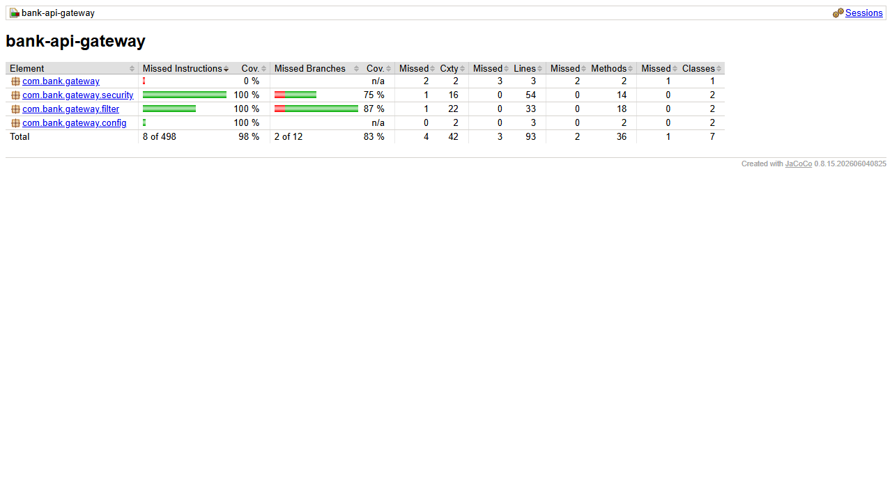

# bank-api-gateway

Punto de entrada unico del sistema bancario, con Spring Cloud Gateway
(reactivo, sin Spring MVC). Recibe todo el trafico externo en el puerto 8080 y lo
enruta por nombre de Eureka (`lb://`) al microservicio correspondiente.

## Requisitos

- Java 17
- Maven 3.9+
- `bank-config-server` (8888) y `bank-eureka-server` (8761) arriba

## Variables de entorno

| Variable | Por defecto | Descripcion |
|---|---|---|
| `CONFIG_SERVER_URL` | `http://localhost:8888` | URL del Config Server |
| `EUREKA_URL` | `http://localhost:8761/eureka` | URL de Eureka |

## Arranque

```bash
mvn clean package
mvn spring-boot:run
```

Es el ultimo en arrancar.

## Rutas

Definidas en `bank-config-repo/bank-api-gateway.yml`:

| Ruta externa | Destino |
|---|---|
| `/customers/**` | `lb://bank-customer-service` |
| `/accounts/**` | `lb://bank-account-service` |
| `/credits/**` | `lb://bank-credit-service` |
| `/credit-cards/**` | `lb://bank-credit-card-service` |
| `/transactions/**`, `/reports/**` | `lb://bank-transaction-service` |

Cualquier otra ruta responde 404.

## Endpoints internos bloqueados

`InternalEndpointBlockingFilter` (un `GlobalFilter` que corre antes del
enrutamiento) responde **403** a toda ruta que coincida con
`bank.gateway.blocked-paths` (por defecto `/**/balance-operations`). Esos
endpoints solo los usa `bank-transaction-service`, que llama a los servicios
directamente por Eureka sin pasar por el gateway.

```bash
curl -X POST http://localhost:8080/accounts/x/balance-operations \
     -H "Content-Type: application/json" -d '{"operation":"DEPOSIT","amount":1}'
# 403 {"status":403,"error":"Forbidden","message":"Internal endpoint not exposed by the gateway",...}
```

## Patrones

- **Filtro / interceptor** (`GlobalFilter`): seguridad transversal sin tocar
  los microservicios.

---

# Parte III: seguridad con JWT

- `spring-boot-starter-security` (reactivo, `SecurityWebFilterChain`) +
  `spring-boot-starter-oauth2-resource-server`. Valida firma HS256 y expiracion
  con el mismo `JWT_SECRET` de `bank-auth-service`.
- Sin token, token invalido o vencido: **401**. Rol insuficiente: **403**. Ambos
  con el cuerpo de error uniforme.

| Ruta o metodo | Rol |
|---|---|
| `POST /auth/login`, `POST /auth/register`, `/actuator/health` | Publico |
| `/auth/users/**`, `/admin/**`, resto de `/actuator/**` | `ADMIN` |
| `PUT`, `DELETE` | `ADMIN` |
| `GET`, `POST` | `USER` o `ADMIN` |

- `UserHeadersFilter` elimina cualquier `X-User-*` (y `X-Customer-Id`) que envie el
  cliente y agrega `X-User-Id`, `X-User-Roles`, `X-Customer-Id` y `X-User-Phone`
  desde el token (informativas para los servicios).
- Rutas nuevas: `/auth/**`, `/debit-cards/**`, `/yanki/**`, y
  `/admin/customers|accounts|credits|credit-cards/**` (reescritas a `/admin/**`
  del servicio).
- Los endpoints internos `.../balance-operations` siguen bloqueados (403).

| Variable | Descripcion |
|---|---|
| `JWT_SECRET` | Obligatoria (minimo 32 bytes); sin ella el gateway no arranca |

Calidad: 11 tests (roles, 401 con token ausente, invalido, de otra firma y
vencido, cabeceras, filtro de endpoints internos); cobertura 96.8%.


