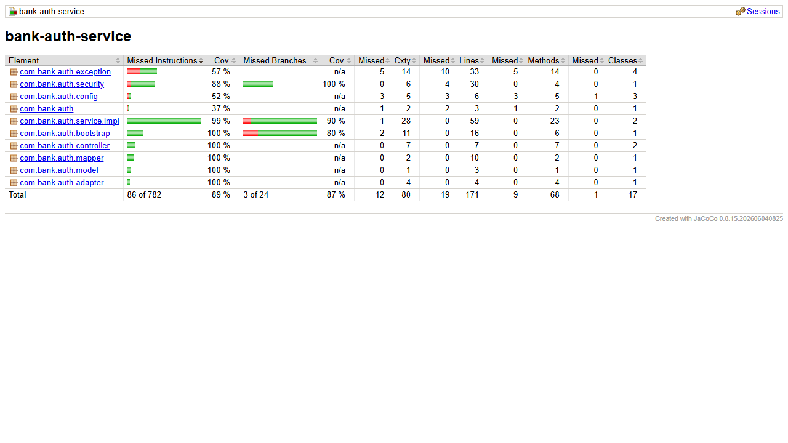

# bank-auth-service

Microservicio nuevo de la Parte III: **usuarios y emision de JWT**. El API
Gateway valida los tokens con el mismo secreto y aplica los roles. Este servicio
no llama a otros microservicios (solo se registra en Eureka) y no usa Kafka.

## Requisitos

- Java 17, Maven 3.9+
- MongoDB (base `bank_auth`)
- `bank-config-server` (8888) y `bank-eureka-server` (8761) arriba

## Variables de entorno

| Variable | Por defecto | Descripcion |
|---|---|---|
| `CONFIG_SERVER_URL` | `http://localhost:8888` | URL del Config Server |
| `JWT_SECRET` | **sin valor** (obligatoria) | Secreto HS256, minimo 32 bytes. Debe ser el mismo del gateway. Sin el, el servicio no arranca |
| `JWT_EXPIRATION` | `60m` | Duracion del token |
| `ADMIN_USERNAME` / `ADMIN_PASSWORD` | sin valor | Administrador inicial: se crea al arrancar si no existe ningun `ADMIN` |
| `MONGO_URI` | `mongodb://localhost:27017/bank_auth` | Base de datos |

Los secretos nunca van en el repositorio (en Docker, en `bank-docs/docker/.env`).

## Arranque

```bash
export JWT_SECRET='un-secreto-largo-de-al-menos-32-bytes'
export ADMIN_USERNAME=admin ADMIN_PASSWORD='Admin123!'
mvn clean package
mvn spring-boot:run      # puerto 8086
```

## Endpoints

| Metodo | URL | Acceso | Exito |
|---|---|---|---|
| POST | `/auth/register` | Publico (crea rol `USER`) | 201 |
| POST | `/auth/login` | Publico | 200 `{ accessToken, tokenType: "Bearer", expiresIn }` |
| POST | `/auth/users` | ADMIN | 201 |
| GET | `/auth/users` | ADMIN | 200 |
| GET | `/auth/users/{id}` | ADMIN | 200 |
| PUT | `/auth/users/{id}` | ADMIN | 200 |
| DELETE | `/auth/users/{id}` | ADMIN | 204 |

Especificacion completa: [`docs/openapi.yaml`](docs/openapi.yaml). Diagrama de
clases: [`docs/class-diagram.md`](docs/class-diagram.md). Secuencia de login y
validacion en el gateway: [`bank-docs/docs/sequence-diagrams-part3.md`](../bank-docs/docs/sequence-diagrams-part3.md).

## Reglas

- Contrasenas con **BCrypt**; el hash nunca se devuelve.
- Token HS256 con `sub` (userId), `username`, `roles`, `customerId`,
  `phoneNumber`, `iat` y `exp`. Sin refresh tokens.
- Login invalido (usuario inexistente, clave incorrecta o usuario deshabilitado):
  **401** con el mismo mensaje generico `Invalid username or password`.
- `username` unico (409 si se repite).
- `customerId` es informativo: no se valida (este servicio no usa REST).

## Codigos

| Caso | Codigo |
|---|---|
| Validacion de entrada | 400 |
| Credenciales invalidas | 401 |
| Sin token / rol insuficiente (lo responde el gateway) | 401 / 403 |
| Usuario inexistente | 404 |
| Username repetido | 409 |

## Calidad

- 17 tests unitarios (Mockito): emision y claims del token, secreto corto,
  login valido e invalido, registro, CRUD, administrador inicial y controladores.
- Cobertura: 88.9% de lineas (100% en `service.impl`). Reporte en
  `target/site/jacoco/index.html` despues de `mvn verify`.



Patrones: Builder (Lombok), Adapter (`ReactorRxAdapter`).
