# Diagrama de clases - bank-auth-service

```mermaid
classDiagram
    direction LR
    class AuthController {
        +register(RegisterRequest) Single~UserResponse~
        +login(LoginRequest) Single~TokenResponse~
    }
    class UserController {
        +create(UserCreateRequest) Single~UserResponse~
        +findAll() Flowable~UserResponse~
        +findById(String) Single~UserResponse~
        +update(String, UserUpdateRequest) Single~UserResponse~
        +delete(String) Completable
    }
    class AuthService {
        <<interface>>
        +register(RegisterRequest) Single~UserResponse~
        +login(LoginRequest) Single~TokenResponse~
    }
    class UserService {
        <<interface>>
        +create(UserCreateRequest) Single~UserResponse~
        +createUser(username, rawPassword, roles, customerId, phoneNumber) Single~UserResponse~
        +findAll() Flowable~UserResponse~
        +findById(String) Single~UserResponse~
        +update(String, UserUpdateRequest) Single~UserResponse~
        +delete(String) Completable
    }
    class AuthServiceImpl
    class UserServiceImpl
    class JwtTokenProvider {
        -MACSigner signer
        +createToken(User) String
        +expiresInSeconds() long
    }
    class AdminBootstrap {
        +run(ApplicationArguments)
        +ensureAdminExists() Completable
    }
    class User {
        String id
        String username
        String passwordHash
        List~Role~ roles
        String customerId
        String phoneNumber
        boolean enabled
        LocalDateTime createdAt
    }
    class Role {
        <<enumeration>>
        ADMIN
        USER
    }
    class UserRepository {
        <<interface>>
        +findByUsername(String) Mono~User~
        +existsByUsername(String) Mono~Boolean~
        +existsByRolesContaining(Role) Mono~Boolean~
    }
    class JwtProperties {
        String secret
        Duration expiration
    }
    class AdminProperties {
        String username
        String password
    }
    class PasswordEncoder {
        <<interface>>
    }

    AuthController --> AuthService
    UserController --> UserService
    AuthService <|.. AuthServiceImpl
    UserService <|.. UserServiceImpl
    AuthServiceImpl --> UserService
    AuthServiceImpl --> UserRepository
    AuthServiceImpl --> PasswordEncoder : BCrypt
    AuthServiceImpl --> JwtTokenProvider
    UserServiceImpl --> UserRepository
    UserServiceImpl --> PasswordEncoder
    JwtTokenProvider --> JwtProperties
    AdminBootstrap --> UserService
    AdminBootstrap --> AdminProperties
    UserRepository --> User
    User --> Role
```

Patrones: **Builder** (Lombok), **Adapter** (`ReactorRxAdapter`). El login usa el
mismo mensaje para cualquier fallo (`InvalidCredentialsException` → 401).
