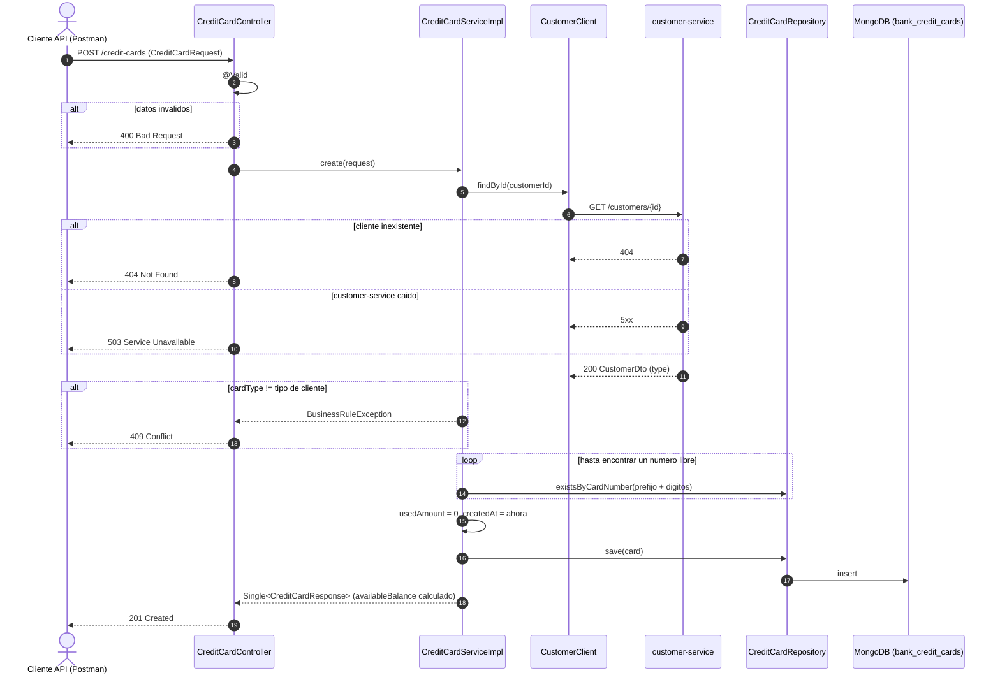
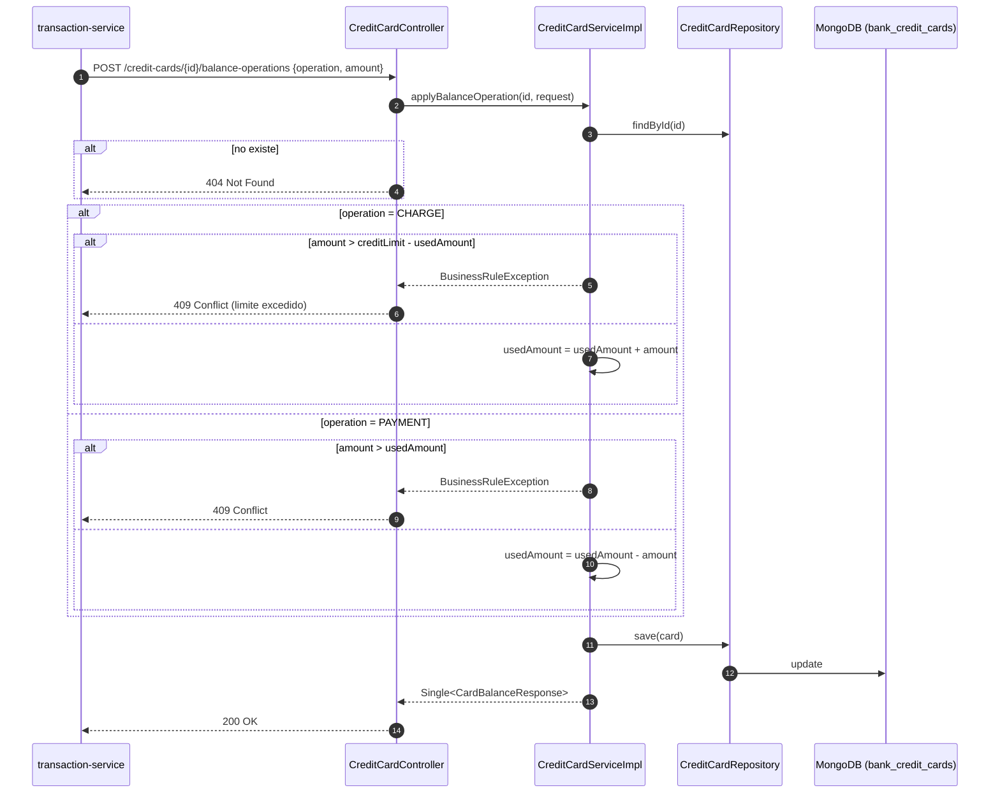
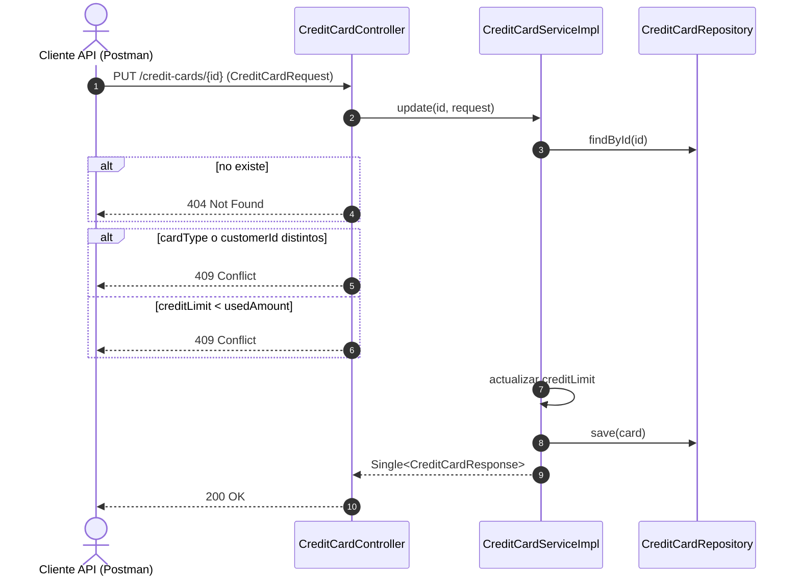

# bank-credit-card-service — Diagramas de secuencia

## 1. Emitir una tarjeta

## 2. Consumo o pago (interno)

Invocado por `bank-transaction-service` en `POST /transactions/charge` y
`POST /transactions/payment`.

## 3. Actualizar una tarjeta

