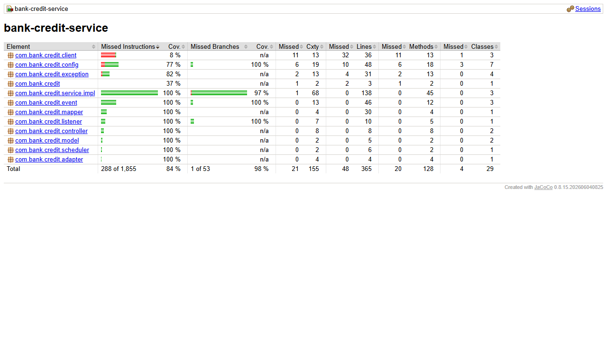

# bank-credit-service

Microservicio de creditos personales y empresariales (productos activos).

## Requisitos

- Java 17
- Maven 3.9+
- MongoDB en `localhost:27017` (base `bank_credits`)
- `bank-config-server` (8888) y `bank-eureka-server` (8761) arriba
- `bank-customer-service` arriba en el puerto 8081

## Variables de entorno

| Variable | Por defecto | Descripcion |
|---|---|---|
| `CONFIG_SERVER_URL` | `http://localhost:8888` | URL del Config Server |

El puerto (8083), la URI de MongoDB, la URL de `customer-service` y el maximo de
creditos personales llegan desde `bank-config-repo/bank-credit-service.yml`:

```yaml
bank:
  services:
    customer-service-url: http://localhost:8081
  rules:
    max-personal-credits: 1
```

## Arranque

```bash
mvn clean package
mvn spring-boot:run
```

## Endpoints

| Metodo | URL | Exito |
|---|---|---|
| POST | `/credits` | 201 |
| GET | `/credits` (filtro opcional `?customerId=`) | 200 |
| GET | `/credits/{id}` | 200 |
| PUT | `/credits/{id}` | 200 |
| DELETE | `/credits/{id}` | 204 |
| GET | `/credits/{id}/balance` | 200 |
| POST | `/credits/{id}/balance-operations` | 200 |

`POST /credits/{id}/balance-operations` es **interno**: lo llama
`bank-transaction-service`.

### Ejemplo de otorgamiento

```json
{
  "creditType": "PERSONAL",
  "customerId": "68f0a1...",
  "grantedAmount": 5000.00,
  "interestRate": 12.5
}
```

### Pago (interno)

```json
{ "operation": "PAYMENT", "amount": 500.00 }
```

## Reglas de negocio

- Cliente `PERSONAL`: solo puede tener **un** credito (configurable), y de tipo
  `PERSONAL`.
- Cliente `BUSINESS`: puede tener varios creditos, todos de tipo `BUSINESS`.
- **No** se exige que el cliente tenga una cuenta bancaria.
- `outstandingBalance` arranca igual a `grantedAmount`.
- Un pago no puede superar `outstandingBalance`.
- En `PUT`, `creditType` y `customerId` son inmutables; `grantedAmount` solo
  puede corregirse mientras el credito no haya recibido pagos.

## Codigos de error

| Caso | Codigo |
|---|---|
| Validacion de entrada | 400 |
| Credito o cliente inexistente | 404 |
| Regla de negocio violada (segundo credito personal, pago mayor al saldo, ...) | 409 |
| `customer-service` no disponible | 503 |

## Stack

Spring Boot 3.3.13, WebFlux, MongoDB reactivo, RxJava 3 en servicios y
controladores (`ReactorRxAdapter` en el borde con el repositorio), WebClient hacia
`customer-service`, Lombok con inyeccion por constructor, Spring Cloud Config,
Logback.

---

# Parte II

## Que cambio

Sin cambios de dominio. Solo infraestructura y calidad:

- Se registra en Eureka con su `spring.application.name` y se accede por el
  gateway (`http://localhost:8080`).
- Llama a `bank-customer-service` por nombre de Eureka
  (`http://bank-customer-service`) con un WebClient `@LoadBalanced`.
- Cada llamada pasa por `RemoteCallDecorator`: circuit breaker y timeout de 2 s
  de Resilience4j (configuracion `default` del `application.yml` comun). Si el
  circuito esta abierto, hay timeout o la conexion se rechaza, responde **503**
  con un mensaje claro. Los 404 y 409 del destino no cuentan como fallo.
- El endpoint interno `balance-operations` queda bloqueado por el gateway (403).
- `MONGO_URI` sobrescribe la URI de Mongo (usado por Docker).

## Orden de arranque

`bank-config-server` → `bank-eureka-server` → `bank-customer-service` →
**este servicio**.

## Calidad

```bash
mvn clean verify    # Checkstyle + tests + reporte y meta de JaCoCo
```

- Reporte: `target/site/jacoco/index.html`. Meta: 80% de lineas en
  `service.impl` (hoy 100%).
- Tests del servicio (Mockito + `TestObserver`) y del controlador
  (`@WebFluxTest` + `WebTestClient`).

## Patrones de diseno

| Patron | Donde |
|---|---|
| Builder | Lombok `@Builder` en documentos y DTOs |
| Adapter | `adapter/ReactorRxAdapter`: puente Reactor ↔ RxJava 3 |
| Decorator | `client/RemoteCallDecorator`: circuit breaker y time limiter sobre cada llamada |

---

# Parte III

## Que cambio

- Campos nuevos `dueDate`, `dueAmount` y `overdueNotified`. Los dos primeros se
  fijan con el `PUT` existente (permite probar la regla en Postman).
- Una deuda esta **vencida** si `dueAmount > 0` y la fecha ya paso.
- **Deteccion diaria**: un `@Scheduled` (cron `bank.debts.overdue-scan-cron`,
  01:00 por defecto) busca con un metodo derivado las deudas vencidas no
  notificadas, publica `DEBT_OVERDUE_DETECTED` en `bank.debt.events` y marca
  `overdueNotified = true`. Para probar sin esperar:
  `POST /admin/overdue-debts/scan` (en el gateway `/admin/credits/overdue-debts/scan`).
- Un **pago** reduce `outstandingBalance` y `dueAmount` (sin bajar de 0). Si la deuda estaba
  notificada y `dueAmount` llega a 0 (o un PUT mueve el vencimiento), publica
  `DEBT_OVERDUE_CLEARED` y baja la marca.
- **Regla de adquisicion**: consume `bank.debt.events` (copia `overdue_debts`) y
  rechaza con 409 crear un producto a un cliente con deuda vencida.

## Variables de entorno nuevas

| Variable | Por defecto |
|---|---|
| `KAFKA_BOOTSTRAP_SERVERS` | `localhost:9092` |
| `OVERDUE_SCAN_CRON` | `0 0 1 * * *` |

## Calidad

39 tests. Cobertura 86.8% de lineas (100% en `service.impl`).


