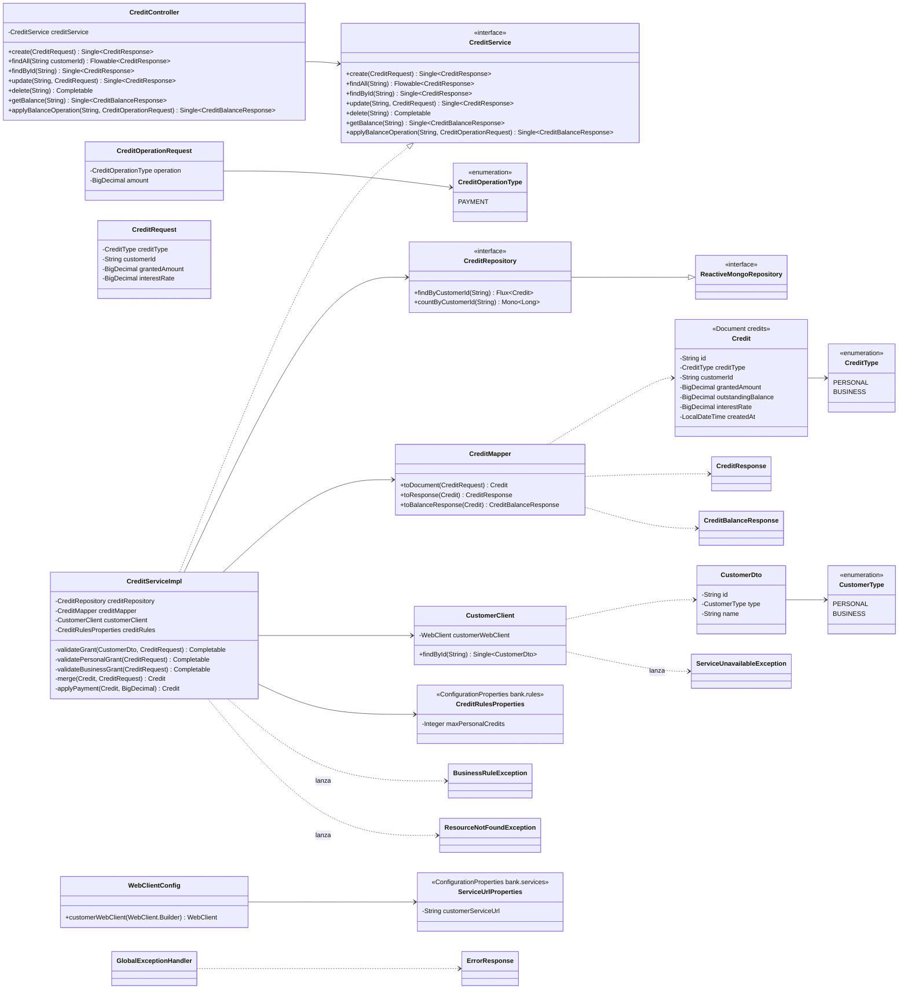
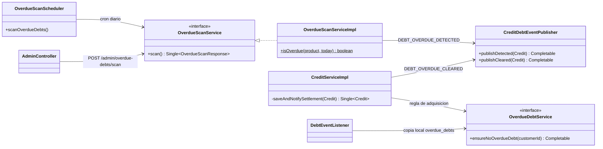

# bank-credit-service — Diagrama de clases



## Parte II: Eureka, Resilience4j y adaptador Reactor - RxJava

```mermaid
classDiagram
    direction LR

    class CustomerClient {
        -WebClient customerWebClient
        -RemoteCallDecorator remoteCallDecorator
        +findById(String) Single~CustomerDto~
    }
    class RemoteCallDecorator {
        -CircuitBreakerRegistry circuitBreakerRegistry
        -TimeLimiterRegistry timeLimiterRegistry
        +decorate(String serviceName, Mono~T~ call) Mono~T~
    }
    class WebClientConfig {
        +loadBalancedWebClientBuilder() WebClient.Builder
        +customerWebClient(WebClient.Builder) WebClient
    }
    class ReactorRxAdapter {
        <<Adapter>>
        +monoToSingle(Mono) Single
        +monoToMaybe(Mono) Maybe
        +fluxToFlowable(Flux) Flowable
        +monoToCompletable(Mono) Completable
    }
    class ServiceUnavailableException
    class GlobalExceptionHandler

    CustomerClient --> RemoteCallDecorator : circuit breaker y timeout 2 s
    CustomerClient ..> ReactorRxAdapter
    WebClientConfig ..> CustomerClient : WebClient balanceado (http://bank-customer-service)
    RemoteCallDecorator ..> ServiceUnavailableException : circuito abierto, timeout o conexion rechazada
    GlobalExceptionHandler ..> ServiceUnavailableException : 503
```

La excepcion `RemoteServiceException` de la Parte I ahora se llama `ServiceUnavailableException`.
Las excepciones de negocio (`ResourceNotFoundException`, `BusinessRuleException`)
no cuentan como fallo del circuito.

## Parte III: deuda vencida


