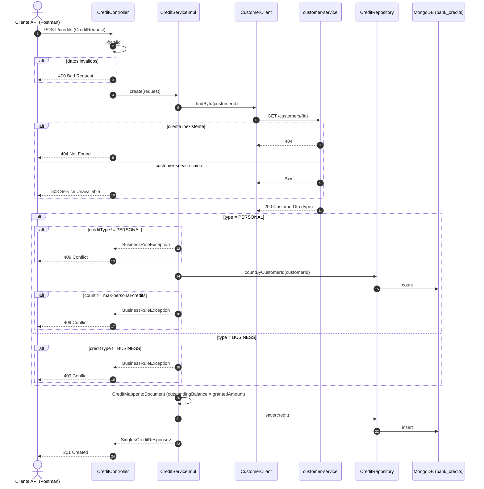
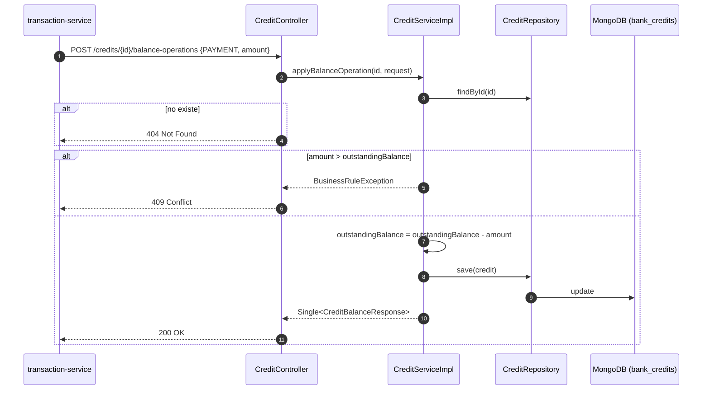
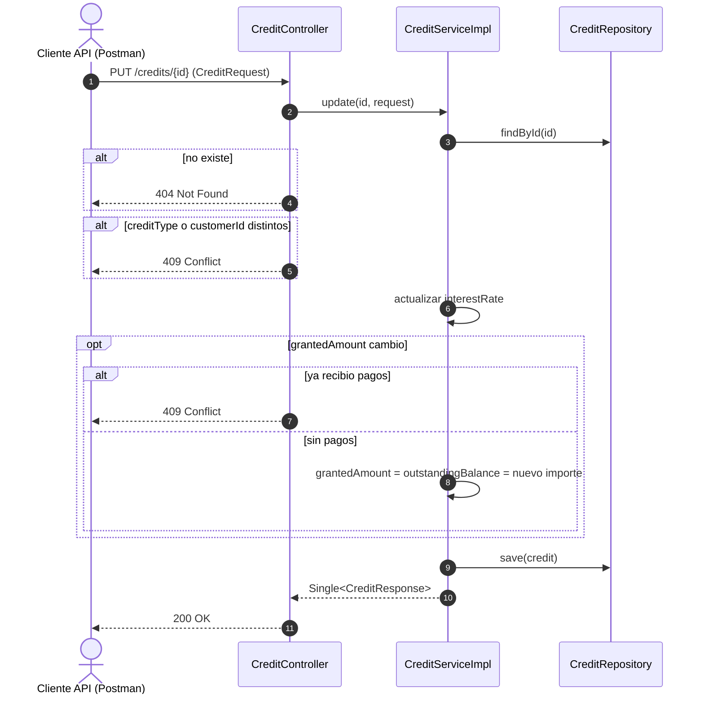

# bank-credit-service — Diagramas de secuencia

## 1. Otorgar un credito

## 2. Pago de credito (interno)

Invocado por `bank-transaction-service` en `POST /transactions/payment`.

## 3. Actualizar un credito

