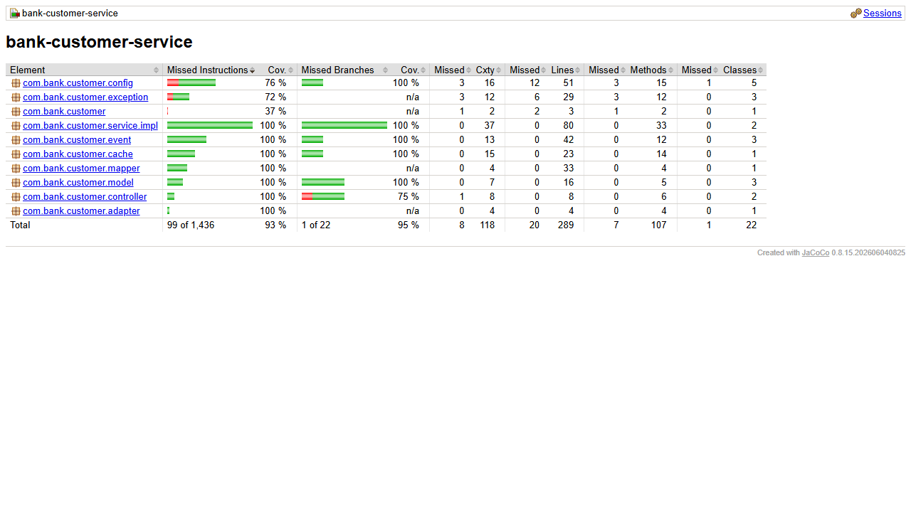

# bank-customer-service

Microservicio de clientes. Es la fuente de verdad del **tipo de cliente**
(`PERSONAL` / `BUSINESS`), dato que consultan los servicios de cuentas, creditos
y tarjetas de credito.

## Requisitos

- Java 17
- Maven 3.9+
- MongoDB en `localhost:27017` (base `bank_customers`)
- `bank-config-server` (8888) y `bank-eureka-server` (8761) arriba

## Variables de entorno

| Variable | Por defecto | Descripcion |
|---|---|---|
| `CONFIG_SERVER_URL` | `http://localhost:8888` | URL del Config Server |

El puerto (8081) y la URI de MongoDB llegan desde
`bank-config-repo/bank-customer-service.yml`.

## Arranque

```bash
mvn clean package
mvn spring-boot:run
```

## Endpoints

| Metodo | URL | Exito |
|---|---|---|
| POST | `/customers` | 201 |
| GET | `/customers` | 200 |
| GET | `/customers/{id}` | 200 |
| PUT | `/customers/{id}` | 200 |
| DELETE | `/customers/{id}` | 204 |

### Ejemplo de creacion

```json
{
  "type": "PERSONAL",
  "documentType": "DNI",
  "documentNumber": "45678912",
  "name": "Ana Torres",
  "email": "ana.torres@example.com",
  "phoneNumber": "999888777",
  "address": "Av. Siempre Viva 123"
}
```

## Reglas de negocio

- `documentNumber` es unico en todo el sistema (indice unico en MongoDB).
- `type` es obligatorio.
- `profile` arranca en `STANDARD`; es un campo reservado para la Parte II.
- Al actualizar, si cambia `documentNumber` se verifica que el nuevo valor este libre.

## Codigos de error

| Caso | Codigo |
|---|---|
| Validacion de entrada | 400 |
| Cliente inexistente | 404 |
| `documentNumber` duplicado | 409 |

## Stack

Spring Boot 3.3.13, WebFlux, MongoDB reactivo, RxJava 3 en servicios y
controladores (`ReactorRxAdapter` en el borde con el repositorio), Lombok con
inyeccion por constructor, Spring Cloud Config, Logback.

---

# Parte II

## Que cambio

- **Perfiles**: `profile` admite `STANDARD` (default), `VIP` y `PYME`. `VIP` solo
  para clientes `PERSONAL` y `PYME` solo para `BUSINESS`; otra combinacion
  responde **409**. Se valida al crear y al actualizar (sobre el resultado final,
  por si cambia el tipo). Las condiciones del perfil (tener tarjeta) se validan
  al abrir la cuenta, en `bank-account-service`.
- Se registra en Eureka como `bank-customer-service` y se accede por el gateway:
  `http://localhost:8080/customers`.
- `MONGO_URI` sobrescribe la URI de Mongo (usado por Docker).

## Orden de arranque

`bank-config-server` → `bank-eureka-server` → **este servicio**.

## Calidad

```bash
mvn clean verify    # Checkstyle + tests + reporte y meta de JaCoCo
```

- Checkstyle (`checkstyle.xml`, basado en Google Checks) corre en `validate` y
  corta el build si hay violaciones.
- Reporte de cobertura: `target/site/jacoco/index.html`. Meta: 80% de lineas en
  `service.impl` (hoy 100%).
- Tests: `CustomerServiceImplTest` (Mockito + `TestObserver` de RxJava 3) y
  `CustomerControllerTest` (`@WebFluxTest` + `WebTestClient`).

## Patrones de diseno

| Patron | Donde |
|---|---|
| Builder | Lombok `@Builder` en `Customer`, `CustomerRequest`, `CustomerResponse` |
| Adapter | `adapter/ReactorRxAdapter`: unico puente entre `Mono`/`Flux` y `Single`/`Flowable`/`Completable` |

---

# Parte III

## Que cambio

- **Eventos**: publica `CUSTOMER_UPSERTED` al crear y actualizar, y
  `CUSTOMER_DELETED` al eliminar, en `bank.customer.events` (clave `customerId`).
  Un fallo de Kafka no revierte la operacion: queda en el log con ERROR.
- **Cache Redis** (`CustomerCache`, cache-aside): claves `customer:id:{id}` y
  `customer:doc:{documentNumber}`, TTL 10 min. Se lee de Redis y, si no esta, de
  MongoDB guardando el resultado; al crear se guarda y al actualizar o eliminar se
  invalidan las claves (incluida la del documento anterior). Si Redis no responde
  en 500 ms se registra WARN y se sigue contra MongoDB: **nunca falla la peticion**.
- `GET /customers?documentNumber=` busca por documento usando la cache.
- `POST /admin/events/republish` (ADMIN; en el gateway
  `/admin/customers/events/republish`) republica un snapshot por cliente.

## Variables de entorno nuevas

| Variable | Por defecto |
|---|---|
| `KAFKA_BOOTSTRAP_SERVERS` | `localhost:9092` |
| `REDIS_HOST` / `REDIS_PORT` | `localhost` / `6379` |

## Calidad

45 tests (incluye cache con Redis caido y lento, publicacion y republicacion).
Cobertura 93.1% de lineas (100% en `service.impl`).


