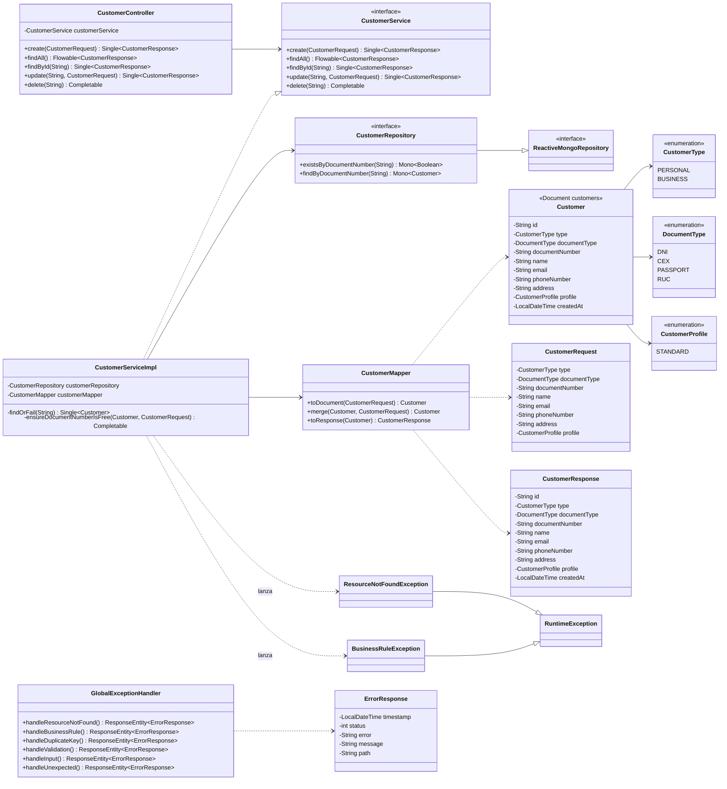
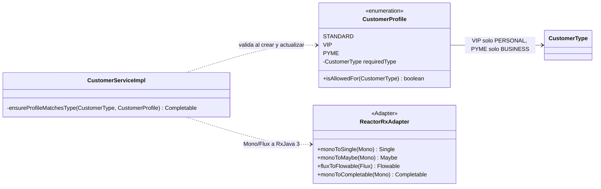
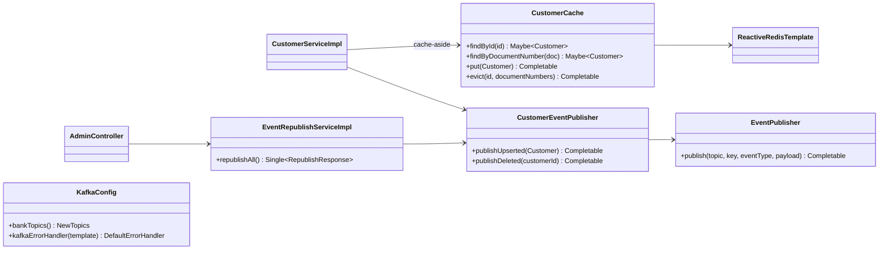

# bank-customer-service — Diagrama de clases

## Parte II: perfiles y adaptador Reactor - RxJava

El servicio se registra en Eureka como `bank-customer-service`. No llama a otros
servicios, por eso no tiene capa `client/` ni circuit breaker.

## Parte III: eventos y cache Redis

`CustomerCache` nunca falla: si Redis no responde (timeout de 500 ms), registra
WARN y el servicio sigue contra MongoDB. Un fallo al publicar no revierte la
operacion (ERROR en el log; se recupera con `POST /admin/events/republish`).
