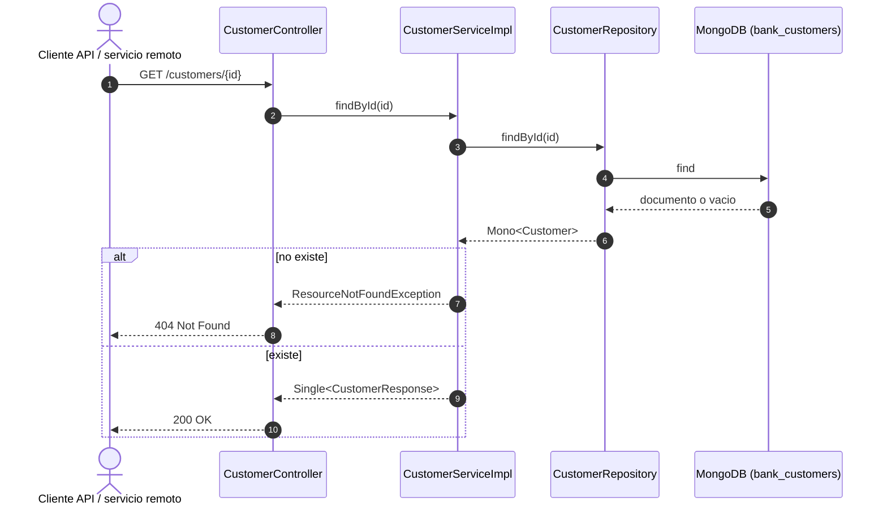
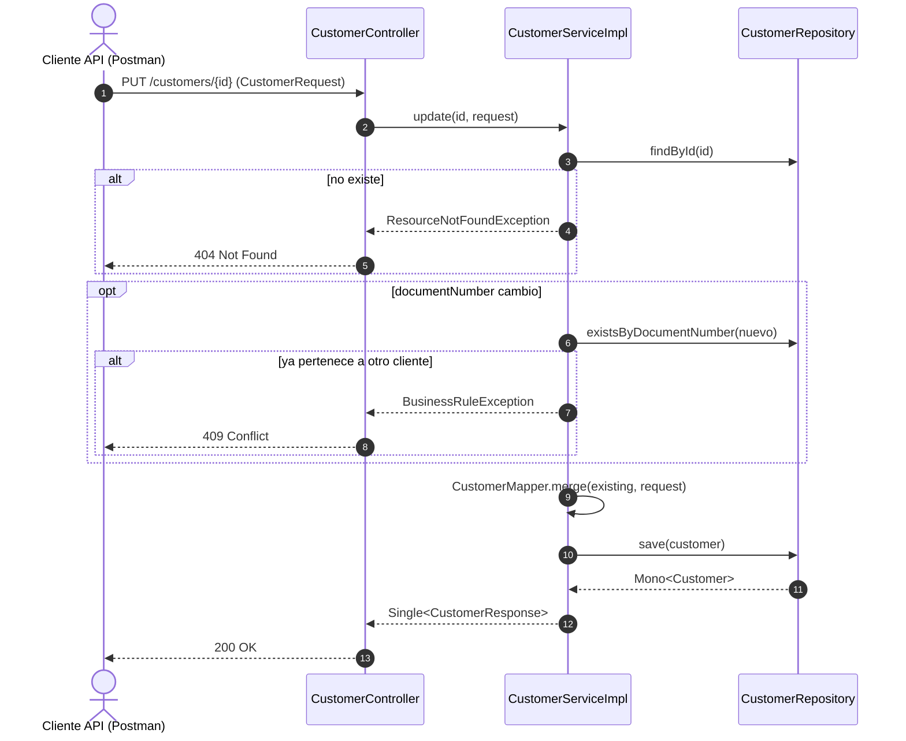
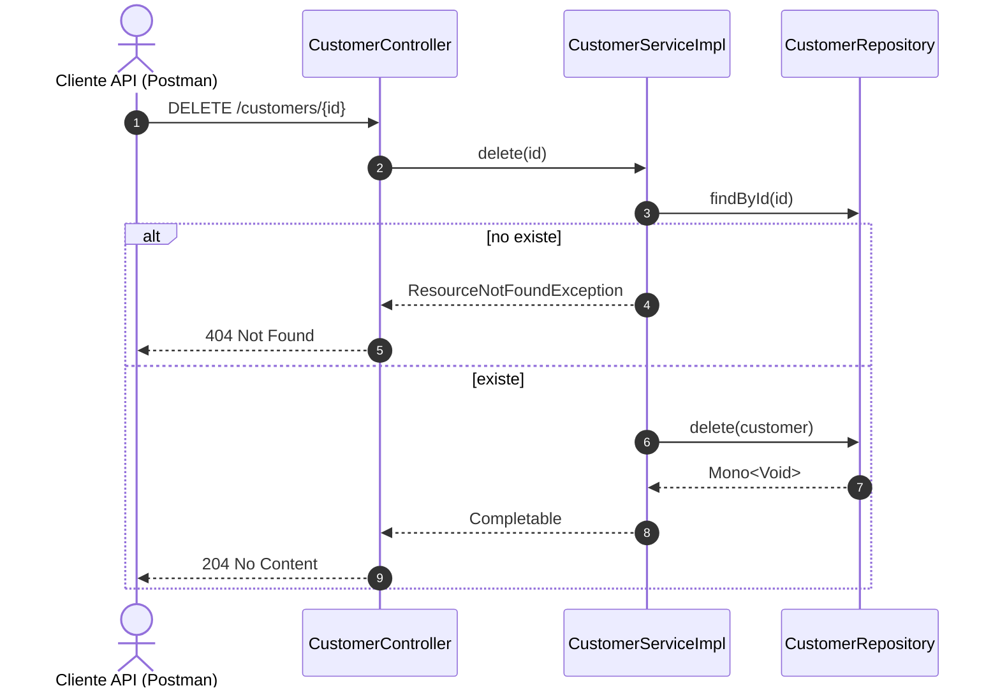

# bank-customer-service — Diagramas de secuencia

## 1. Crear cliente

```mermaid
sequenceDiagram
    autonumber
    actor C as Cliente API (Postman)
    participant CT as CustomerController
    participant S as CustomerServiceImpl
    participant R as CustomerRepository
    participant DB as MongoDB (bank_customers)

    C->>CT: POST /customers (CustomerRequest)
    CT->>CT: @Valid
    alt datos invalidos
        CT-->>C: 400 Bad Request
    end
    CT->>S: create(request)
    S->>R: existsByDocumentNumber(documentNumber)
    R->>DB: count customers
    DB-->>R: resultado
    R-->>S: Mono<Boolean>
    alt documento ya registrado
        S-->>CT: BusinessRuleException
        CT-->>C: 409 Conflict
    else documento libre
        S->>S: CustomerMapper.toDocument (profile=STANDARD, createdAt)
        S->>R: save(customer)
        R->>DB: insert
        DB-->>R: documento con id
        R-->>S: Mono<Customer>
        S-->>CT: Single<CustomerResponse>
        CT-->>C: 201 Created
    end
```

## 2. Consultar cliente por id

Lo usan tambien `account-service`, `credit-service` y `credit-card-service`
para conocer el tipo de cliente.

## 3. Actualizar cliente

## 4. Eliminar cliente

