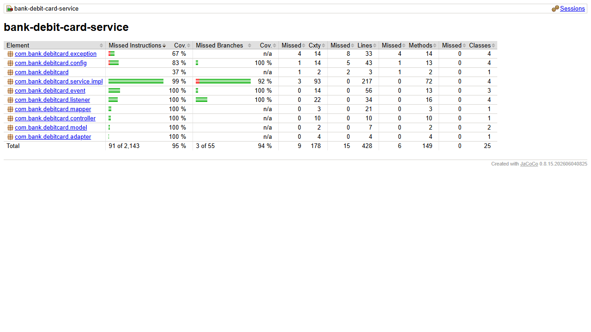

# bank-debit-card-service

Microservicio nuevo de la Parte III: **tarjetas de debito y sus pagos**.

No llama a otros microservicios por REST. Mantiene copias locales alimentadas por
Kafka (`customers_replica`, `accounts_replica`, `overdue_debts`) y cobra los pagos
pidiendo retiros por Kafka a `bank-account-service`.

## Requisitos

- Java 17, Maven 3.9+
- MongoDB (base `bank_debit_cards`) y Kafka
- `bank-config-server` (8888) y `bank-eureka-server` (8761) arriba

## Variables de entorno

| Variable | Por defecto | Descripcion |
|---|---|---|
| `CONFIG_SERVER_URL` | `http://localhost:8888` | URL del Config Server |
| `KAFKA_BOOTSTRAP_SERVERS` | `localhost:9092` | Broker de Kafka |
| `MONGO_URI` | `mongodb://localhost:27017/bank_debit_cards` | Base de datos |

Puerto 8087. Prefijo del numero de tarjeta: `bank.debit-cards.card-number-prefix`
(config repo).

## Arranque

```bash
mvn clean package
mvn spring-boot:run
```

## Endpoints

| Metodo | URL | Exito |
|---|---|---|
| POST | `/debit-cards` | 201 |
| GET | `/debit-cards` (`?customerId=`) | 200 |
| GET | `/debit-cards/{id}` | 200 |
| PUT | `/debit-cards/{id}` | 200 |
| DELETE | `/debit-cards/{id}` | 204 |
| POST | `/debit-cards/{id}/accounts` `{ "accountId" }` | 200 |
| PUT | `/debit-cards/{id}/main-account` `{ "accountId" }` | 200 |
| POST | `/debit-cards/{id}/payments` `{ "amount", "description" }` | **202** `{ paymentId, status: "PENDING" }` |
| GET | `/debit-cards/{id}/payments` | 200 |
| GET | `/debit-cards/{id}/payments/{paymentId}` | 200 |

El saldo de la tarjeta es el de su cuenta principal:
`GET /accounts/{mainAccountId}/balance`.

Especificacion: [`docs/openapi.yaml`](docs/openapi.yaml) · clases:
[`docs/class-diagram.md`](docs/class-diagram.md) · secuencia del pago:
[`bank-docs/docs/sequence-diagrams-part3.md`](../bank-docs/docs/sequence-diagrams-part3.md).

## Reglas al crear una tarjeta (todas contra las copias locales)

- El cliente existe en `customers_replica` (si no, 404).
- Todas las cuentas existen en `accounts_replica` (404) y son del cliente (409).
- `mainAccountId` esta entre `accountIds` y no hay cuentas repetidas (409).
- El cliente no tiene deuda vencida (409, regla de adquisicion).

## Pago con fallback

1. Se crea el pago en `PENDING` y se publica un `WITHDRAWAL` contra la **cuenta
   principal** (`origin = DEBIT_CARD`, `reference = cardId`).
2. `ACCOUNT_OPERATION_COMPLETED` → el pago pasa a `COMPLETED` con la cuenta cobrada.
3. `ACCOUNT_OPERATION_REJECTED` → se intenta la **siguiente cuenta asociada**, en
   orden de asociacion. Si no quedan, el pago termina `FAILED` con el motivo.
4. Los resultados se enlazan por `currentOperationId`; cada evento se procesa una
   sola vez (`processed_events`).

Si Kafka no acepta la peticion, el pago queda `FAILED` (`KAFKA_UNAVAILABLE`) y se
responde 503. Una tarjeta `INACTIVE` no admite pagos (409).

## Cuentas eliminadas

Al recibir `ACCOUNT_DELETED` la cuenta se quita de las tarjetas. Si era la
principal y quedan otras, la primera pasa a ser la principal; si no queda
ninguna, la tarjeta queda `INACTIVE`. Se publica el nuevo snapshot.

## Eventos

| Topic | Rol | Eventos |
|---|---|---|
| `bank.debit-card.events` | publica | `DEBIT_CARD_UPSERTED`, `DEBIT_CARD_DELETED` |
| `bank.account.operation-requests` | publica | `ACCOUNT_OPERATION_REQUESTED` (WITHDRAWAL) |
| `bank.customer.events` | consume | copia `customers_replica` |
| `bank.account.events` | consume | copia `accounts_replica` y bajas de cuentas |
| `bank.debt.events` | consume | copia `overdue_debts` |
| `bank.account.operation-results` | consume | avance de los pagos |

Catalogo completo: [`bank-docs/docs/events.md`](../bank-docs/docs/events.md).

## Calidad

- 52 tests unitarios (Mockito): reglas de creacion, fallback a la segunda cuenta,
  pago fallido, cuenta eliminada (principal y ultima), idempotencia, listeners,
  publicador y controlador.
- Cobertura: 96.5% de lineas (100% en `service.impl`).


