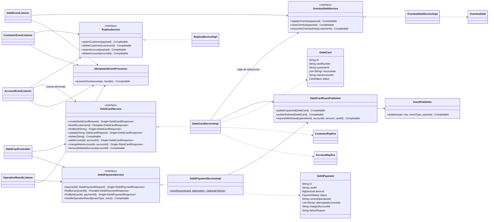

# Diagrama de clases - bank-debit-card-service

Patrones: **Coreografia** (saga por eventos con fallback de cuentas),
**Observer/Pub-Sub** (listeners de Kafka), **Idempotent Consumer**
(`IdempotentEventProcessor` + `processed_events`), **Read model / copia local**
(replicas), **Adapter** (`ReactorRxAdapter`), **Builder** (Lombok).
