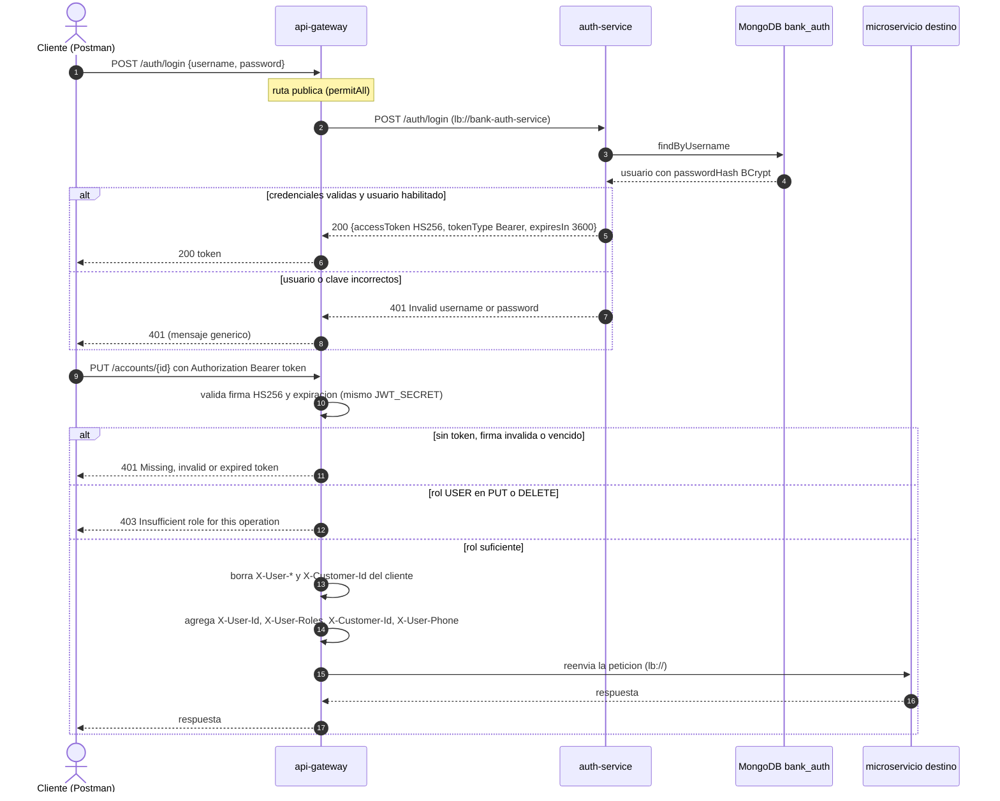
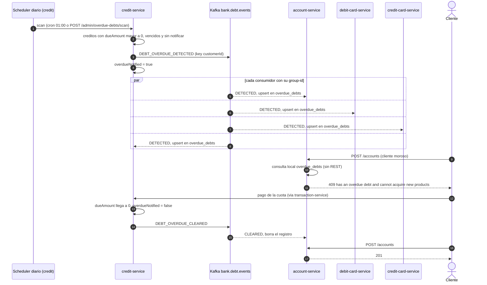
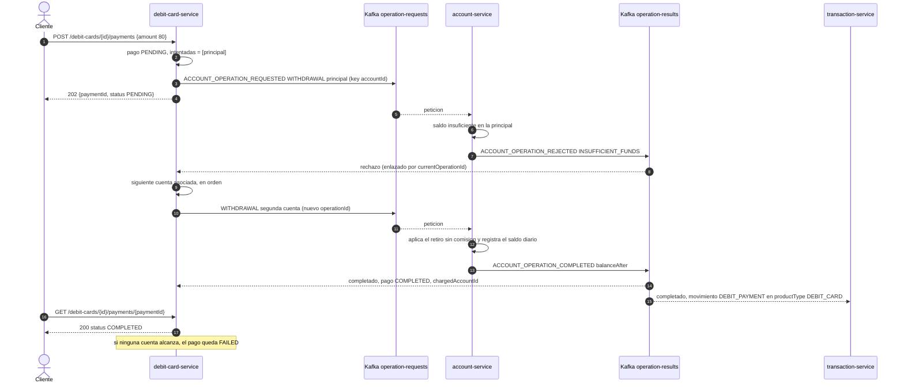
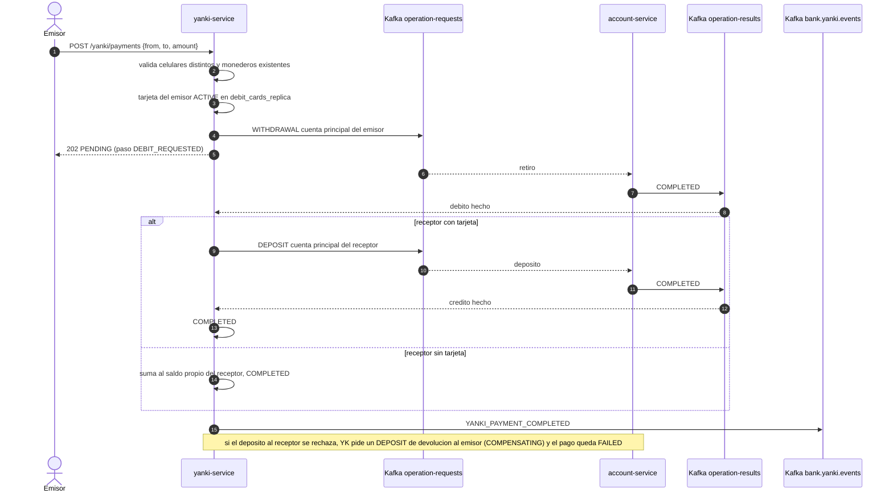
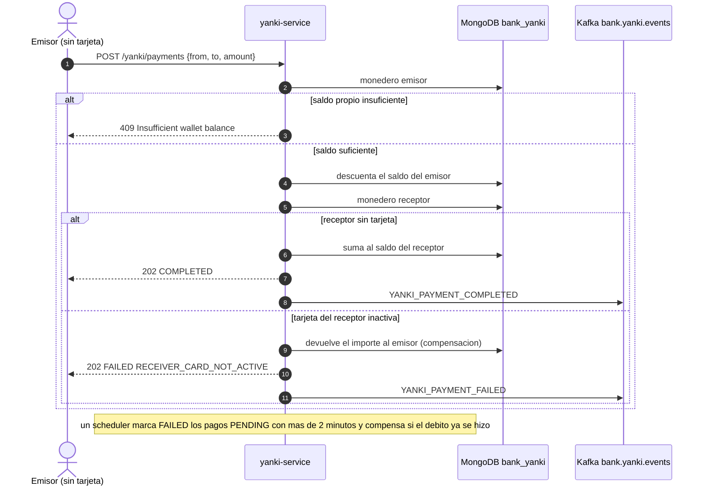
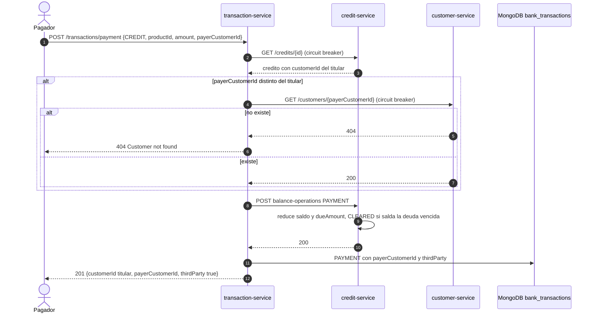

# Diagramas de secuencia - Parte III

## 1. Login y validacion del JWT en el gateway

## 2. Propagacion de la deuda vencida

## 3. Pago con tarjeta de debito con fallback

## 4. Pago Yanki con tarjeta asociada

## 5. Pago Yanki sin tarjeta y compensacion

## 6. Pago de terceros

