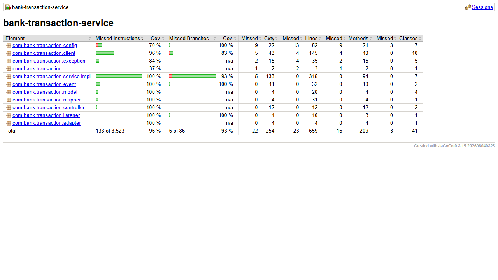

# bank-transaction-service

Microservicio de movimientos: depositos, retiros, pagos y consumos. Es el dueno
de los movimientos y de las reglas sobre ellos, y orquesta a los tres servicios
de producto.

## Requisitos

- Java 17
- Maven 3.9+
- MongoDB en `localhost:27017` (base `bank_transactions`)
- `bank-config-server` (8888) y `bank-eureka-server` (8761) arriba
- `bank-account-service` (8082), `bank-credit-service` (8083) y
  `bank-credit-card-service` (8084) arriba

Es el **ultimo** servicio del orden de arranque.

## Variables de entorno

| Variable | Por defecto | Descripcion |
|---|---|---|
| `CONFIG_SERVER_URL` | `http://localhost:8888` | URL del Config Server |

El puerto (8085), la URI de MongoDB y las URLs de los servicios de producto
llegan desde `bank-config-repo/bank-transaction-service.yml`:

```yaml
bank:
  services:
    account-service-url: http://localhost:8082
    credit-service-url: http://localhost:8083
    credit-card-service-url: http://localhost:8084
```

## Arranque

```bash
mvn clean package
mvn spring-boot:run
```

## Endpoints

| Metodo | URL | Exito |
|---|---|---|
| POST | `/transactions/deposit` | 201 |
| POST | `/transactions/withdrawal` | 201 |
| POST | `/transactions/payment` | 201 |
| POST | `/transactions/charge` | 201 |
| GET | `/transactions` (filtro opcional `?productId=`) | 200 |
| GET | `/transactions/{id}` | 200 |
| PUT | `/transactions/{id}` | 200 |
| DELETE | `/transactions/{id}` | 204 |

### Deposito y retiro

```json
{
  "accountId": "68f0c3...",
  "amount": 150.00,
  "description": "Deposito en ventanilla"
}
```

### Pago de credito o de tarjeta

```json
{
  "productType": "CREDIT_CARD",
  "productId": "68f0d4...",
  "amount": 200.00,
  "description": "Pago de tarjeta"
}
```

`productType` admite `CREDIT` y `CREDIT_CARD`. Enviar `ACCOUNT` devuelve 409.

### Consumo con tarjeta

```json
{
  "creditCardId": "68f0d4...",
  "amount": 80.00,
  "description": "Compra en supermercado"
}
```

### Correccion administrativa (`PUT`)

```json
{ "amount": 90.00, "description": "Importe corregido" }
```

## Flujo de un deposito o retiro

1. Obtener la cuenta por REST a `account-service`.
2. Validar las reglas del tipo de cuenta:
   - `SAVINGS`: movimientos del mes en curso `< monthlyMovementLimit`.
   - `FIXED_TERM`: hoy es `movementDay` y no hay otro movimiento este mes.
   - `CURRENT`: sin restriccion.
3. Llamar a `POST /accounts/{id}/balance-operations`.
4. **Solo si el paso 3 fue exitoso**, guardar la `Transaction`. Si fallo, no se
   guarda nada.

Los pagos y los consumos siguen el mismo patron contra `credit-service` y
`credit-card-service`.

## Reglas de negocio

- El movimiento se registra **despues** de que el servicio dueno confirma el
  cambio de saldo; nunca antes.
- Un 409 de un servicio remoto (fondos insuficientes, limite de tarjeta
  excedido, pago mayor al saldo pendiente) se propaga como 409 con el mensaje
  original.
- `PUT` y `DELETE` son administrativos: **no recalculan saldos**.

## Codigos de error

| Caso | Codigo |
|---|---|
| Validacion de entrada | 400 |
| Movimiento o producto inexistente | 404 |
| Regla de negocio violada (limite mensual, dia incorrecto, fondos insuficientes, ...) | 409 |
| Servicio remoto no disponible | 503 |

## Stack

Spring Boot 3.3.13, WebFlux, MongoDB reactivo, RxJava 3 en servicios y
controladores (`ReactorRxAdapter` en el borde con el repositorio), WebClient hacia
los tres servicios de producto, Lombok con inyeccion por constructor, Spring
Cloud Config, Logback.

---

# Parte II

## Que cambio

### Comision por exceso de transacciones

- Solo los depositos y retiros cuentan y se cobran.
- Si los depositos y retiros de la cuenta en el mes ya alcanzan
  `freeTransactionLimit`, se cobra `transactionFee`. La comision se descuenta de
  la misma cuenta (campo `fee` de `balance-operations`); no se crea un movimiento
  aparte.
- `Transaction` gana `feeCharged` (0 si no hubo comision).
- Las reglas duras de la Parte I siguen vigentes.

### Transferencias

`POST /transactions/transfer` con
`{ sourceAccountId, destinationAccountNumber, amount, description }`.

1. Origen y destino deben existir y ser distintos; el destino se busca con
   `GET /accounts?accountNumber=`.
2. `transferType`: `OWN` (mismo cliente) o `THIRD_PARTY`.
3. Reglas duras de ahorro y plazo fijo en ambas cuentas.
4. Retiro del origen sin comision; sin fondos → 409.
5. Deposito en el destino. Si falla, **compensa** devolviendo el dinero al
   origen, responde con el error y no guarda movimientos. Si la compensacion
   tambien falla, deja un log `ERROR` con los ids para revision manual.
6. Si todo sale bien, guarda `TRANSFER_OUT` y `TRANSFER_IN` con el mismo
   `transferId`.

Las transferencias no cobran comision ni cuentan para el maximo gratuito.

### Reportes

| Metodo | URL |
|---|---|
| GET | `/reports/products/{productType}/{productId}?from=YYYY-MM-DD&to=YYYY-MM-DD` |
| GET | `/reports/products?from=YYYY-MM-DD&to=YYYY-MM-DD` |
| GET | `/reports/last-movements?productType=CREDIT_CARD&productId={id}` |

Los totales se calculan con streams (`groupingBy`, `reducing(BigDecimal::add)`).
Los ultimos 10 usan `findTop10ByProductTypeAndProductIdOrderByCreatedAtDesc`. El
reporte de ultimos movimientos es generico; los tipos admitidos estan en
`bank.reports.last-movements-product-types` (hoy solo `CREDIT_CARD`; la tarjeta de
debito de la Parte III se agrega ahi).

### Infraestructura

Eureka (`bank-transaction-service`), WebClient `@LoadBalanced` hacia los tres
servicios de producto, y un circuit breaker con timeout de 2 s por destino.

## Orden de arranque

Despues de `bank-account-service`, `bank-credit-service` y
`bank-credit-card-service`; antes del gateway.

## Calidad

```bash
mvn clean verify    # Checkstyle + tests + reporte y meta de JaCoCo
```

- Reporte: `target/site/jacoco/index.html`. Meta: 80% de lineas en
  `service.impl` (hoy 100% en las cuatro clases).
- Tests destacados: `AccountMovementRulesTest` (comision al superar el maximo,
  reglas duras con `Clock` fijo), `TransferServiceImplTest` (fondos
  insuficientes, compensacion cuando falla el deposito, compensacion que tambien
  falla), `ReportServiceImplTest` (totales, agrupacion, ultimos 10) y los tests de
  controladores con `@WebFluxTest`.

## Patrones de diseno

| Patron | Donde |
|---|---|
| Builder | Lombok `@Builder` en documentos y DTOs |
| Adapter | `adapter/ReactorRxAdapter`: puente Reactor ↔ RxJava 3 |
| Decorator | `client/RemoteCallDecorator`: circuit breaker y time limiter sobre cada llamada |
| Compensacion (saga por pasos) | `TransferServiceImpl.compensate`: deshace el retiro si el deposito falla |

---

# Parte III

## Que cambio

- **Pago de terceros**: `POST /transactions/payment` acepta `payerCustomerId`
  (opcional). Si es otro cliente, se valida que exista (REST a
  `bank-customer-service` con circuit breaker; 404 si no) y el movimiento queda con
  `payerCustomerId` y `thirdParty = true`. Cualquier credito o tarjeta de credito
  puede pagarlo un tercero.
- **Movimientos desde eventos**: consume `bank.account.operation-results` y guarda
  un movimiento por cada `ACCOUNT_OPERATION_COMPLETED` (idempotente por `eventId` y
  por `operationId`):
  - `origin = DEBIT_CARD`: `productType = DEBIT_CARD`, `productId` = id de la
    tarjeta, `transactionType = DEBIT_PAYMENT`.
  - `origin = YANKI`: `DEPOSIT` o `WITHDRAWAL` sobre la cuenta.
- `Transaction` agrega `payerCustomerId`, `thirdParty`, `origin` (`API` por
  defecto), `accountId`, `reference`, `eventId` y `operationId`.
- `GET /reports/last-movements?productType=DEBIT_CARD&productId={id}` queda
  operativo (cierra el pendiente de la Parte II).
- Los movimientos con origen `DEBIT_CARD` o `YANKI` no cuentan para los maximos
  de movimientos ni para la comision por exceso.

## Variables de entorno nuevas

| Variable | Por defecto |
|---|---|
| `KAFKA_BOOTSTRAP_SERVERS` | `localhost:9092` |
| `CUSTOMER_SERVICE_URL` | `http://bank-customer-service` |

## Calidad

66 tests (incluye clientes REST con respuestas simuladas). Cobertura 96.5% de
lineas (100% en `service.impl`).


