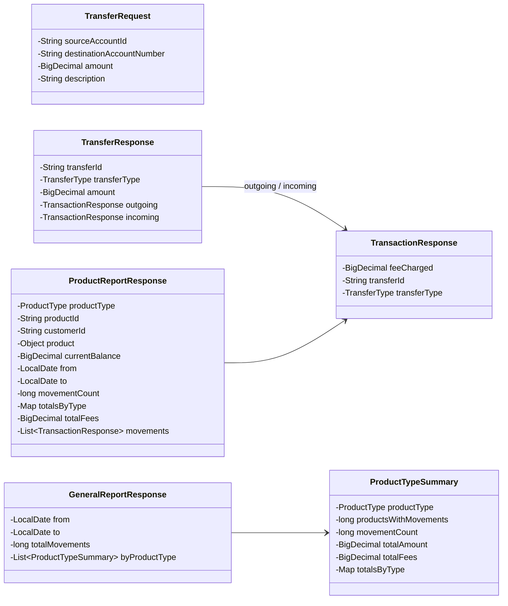
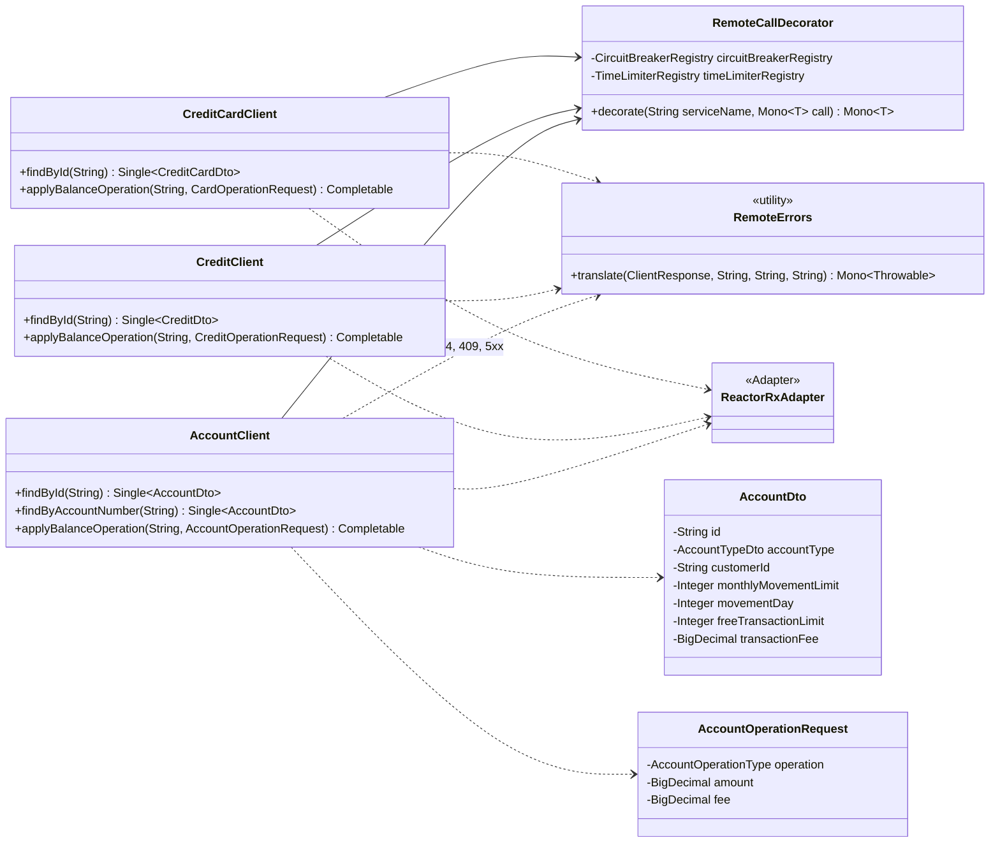
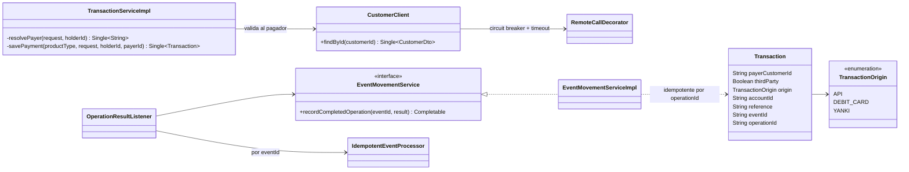

# bank-transaction-service — Diagramas de clases

## 1. Movimientos, transferencias y reportes

```mermaid
classDiagram
    direction LR

    class TransactionController {
        +deposit(AccountTransactionRequest) Single~TransactionResponse~
        +withdrawal(AccountTransactionRequest) Single~TransactionResponse~
        +payment(PaymentRequest) Single~TransactionResponse~
        +charge(ChargeRequest) Single~TransactionResponse~
        +transfer(TransferRequest) Single~TransferResponse~
        +findAll(String productId) Flowable~TransactionResponse~
        +findById(String) Single~TransactionResponse~
        +update(String, TransactionUpdateRequest) Single~TransactionResponse~
        +delete(String) Completable
    }

    class ReportController {
        +productReport(ProductType, String, LocalDate, LocalDate) Single~ProductReportResponse~
        +generalReport(LocalDate, LocalDate) Single~GeneralReportResponse~
        +lastMovements(ProductType, String) Flowable~TransactionResponse~
    }

    class TransactionService {
        <<interface>>
    }
    class TransferService {
        <<interface>>
        +transfer(TransferRequest) Single~TransferResponse~
    }
    class ReportService {
        <<interface>>
    }

    class TransactionServiceImpl {
        -handleAccountMovement(...) Single~TransactionResponse~
        -payCredit(PaymentRequest) Single~TransactionResponse~
        -payCreditCard(PaymentRequest) Single~TransactionResponse~
    }

    class TransferServiceImpl {
        -validate(AccountPair) Completable
        -moveMoney(String, AccountPair, BigDecimal) Completable
        -compensate(...) Completable
        -saveMovements(String, AccountPair, TransferRequest) Single~TransferResponse~
    }

    class ReportServiceImpl {
        -ReportProperties reportProperties
        -productSnapshot(ProductType, String) Single~ProductSnapshot~
        -summaries(List~Transaction~) List~ProductTypeSummary~
        -totalsByType(List~Transaction~) Map
    }

    class AccountMovementRules {
        -TransactionRepository transactionRepository
        -Clock clock
        +validateHardRules(AccountDto) Completable
        +calculateFee(AccountDto) Single~BigDecimal~
    }

    class TransactionRepository {
        <<interface>>
        +findByProductId(String) Flux~Transaction~
        +countByProductIdAndCreatedAtBetween(...) Mono~Long~
        +countByProductIdAndTransactionTypeInAndCreatedAtBetween(...) Mono~Long~
        +findByProductIdAndCreatedAtBetweenOrderByCreatedAtAsc(...) Flux~Transaction~
        +findByCreatedAtBetween(LocalDateTime, LocalDateTime) Flux~Transaction~
        +findTop10ByProductTypeAndProductIdOrderByCreatedAtDesc(ProductType, String) Flux~Transaction~
    }

    class Transaction {
        <<Document transactions>>
        -String id
        -ProductType productType
        -String productId
        -String customerId
        -TransactionType transactionType
        -BigDecimal amount
        -String description
        -BigDecimal feeCharged
        -String transferId
        -TransferType transferType
        -LocalDateTime createdAt
    }

    class TransactionType {
        <<enumeration>>
        DEPOSIT
        WITHDRAWAL
        PAYMENT
        CHARGE
        TRANSFER_OUT
        TRANSFER_IN
    }

    class TransferType {
        <<enumeration>>
        OWN
        THIRD_PARTY
    }

    class ReportProperties {
        <<ConfigurationProperties bank.reports>>
        -Set~ProductType~ lastMovementsProductTypes
    }

    TransactionController --> TransactionService
    TransactionController --> TransferService
    ReportController --> ReportService
    TransactionServiceImpl ..|> TransactionService
    TransferServiceImpl ..|> TransferService
    ReportServiceImpl ..|> ReportService
    TransactionServiceImpl --> AccountMovementRules
    TransferServiceImpl --> AccountMovementRules
    TransactionServiceImpl --> TransactionRepository
    TransferServiceImpl --> TransactionRepository
    ReportServiceImpl --> TransactionRepository
    ReportServiceImpl --> ReportProperties
    AccountMovementRules --> TransactionRepository
    TransactionRepository ..> Transaction
    Transaction --> TransactionType
    Transaction --> TransferType
```

## 2. DTOs de transferencia y reportes

## 3. Comunicacion con otros servicios (Eureka + Resilience4j)

Cada cliente usa una instancia de circuit breaker y de time limiter con el nombre
del servicio destino (`bank-account-service`, `bank-credit-service`,
`bank-credit-card-service`).

## Parte III: pago de terceros y movimientos desde eventos

`ProductType` suma `DEBIT_CARD` y `TransactionType` suma `DEBIT_PAYMENT`. Los
movimientos con origen `DEBIT_CARD` o `YANKI` no cuentan para los maximos ni
para la comision (`AccountMovementRules.EVENT_ORIGINS`).
