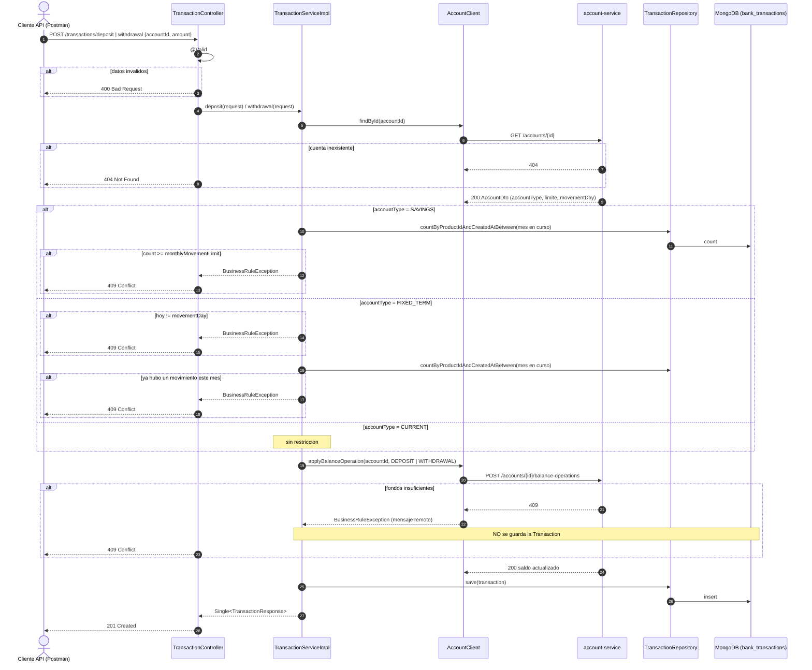
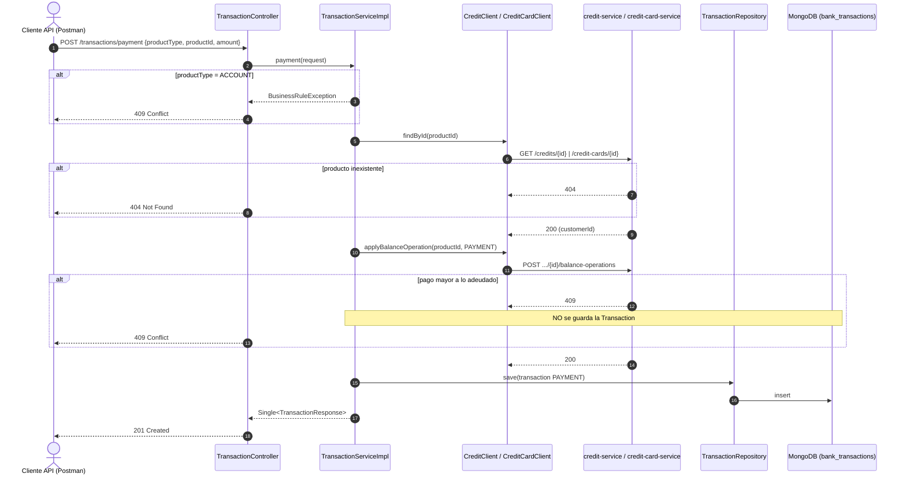
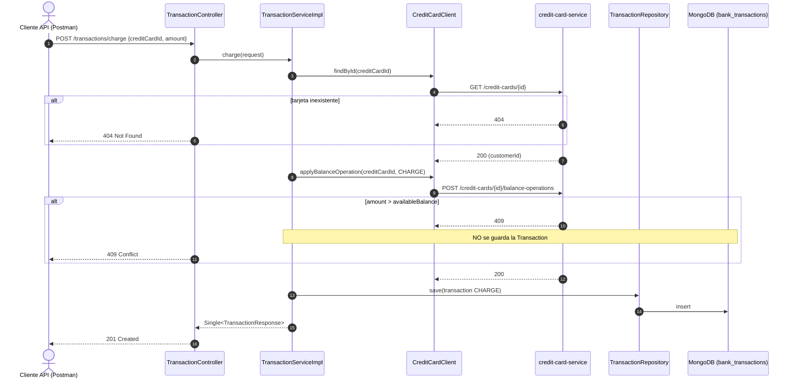
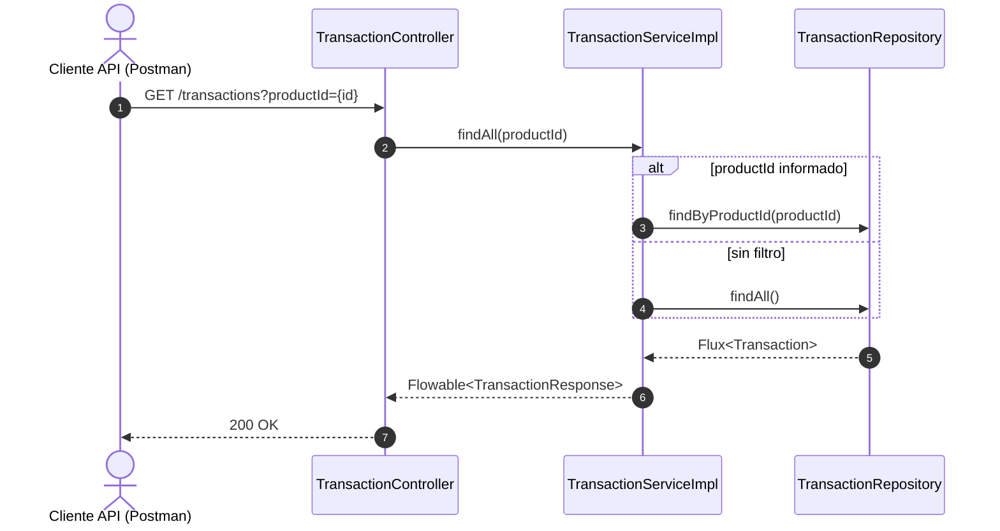
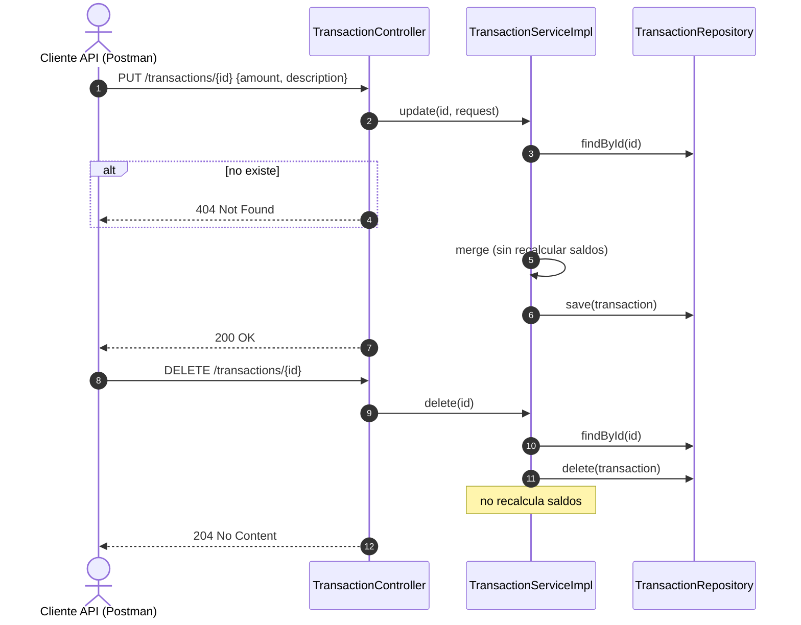
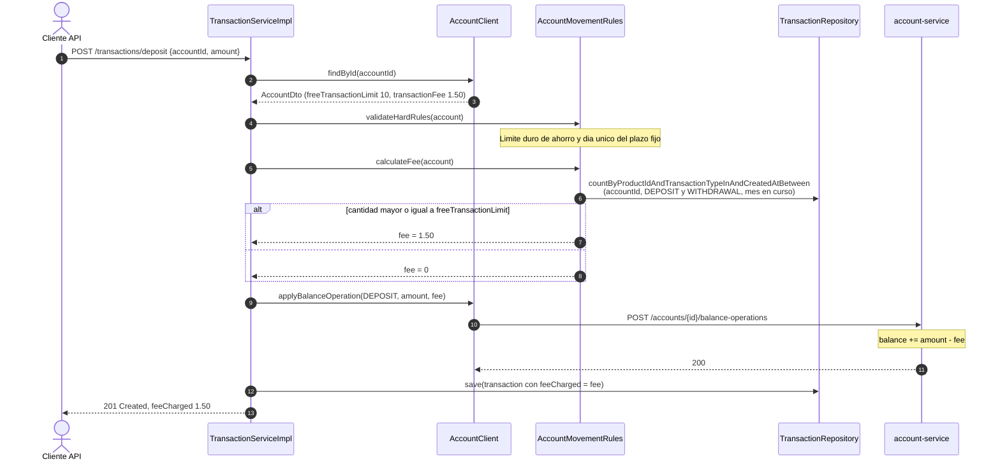
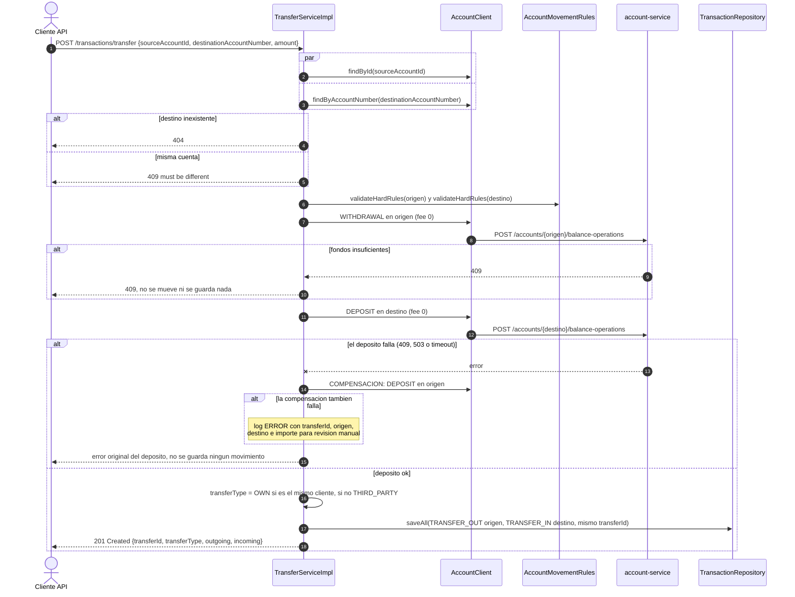
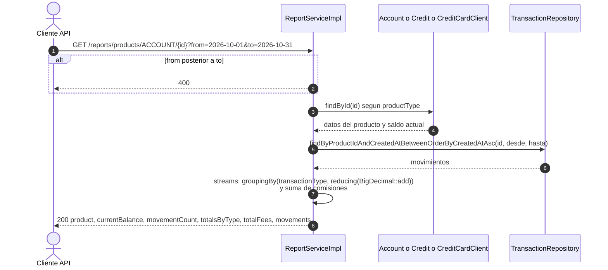
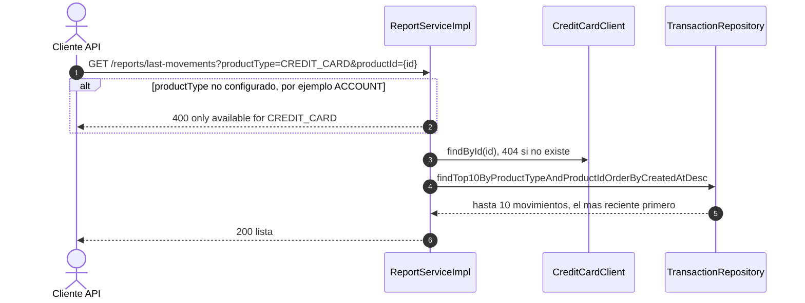

# bank-transaction-service — Diagramas de secuencia

Todas las operaciones que mueven saldo siguen el mismo patron:

1. Obtener el producto del servicio dueno.
2. Validar las reglas propias del movimiento.
3. Pedir el cambio de saldo al servicio dueno.
4. **Solo si el paso 3 fue exitoso**, guardar la `Transaction`.

## 1. Deposito o retiro en cuenta

## 2. Pago de credito o de tarjeta de credito

## 3. Consumo con tarjeta de credito

## 4. Movimientos de un producto

## 5. Correccion y eliminacion administrativa

---

# Parte II

## 6. Deposito o retiro con comision por exceso de transacciones

## 7. Transferencia con compensacion

## 8. Reporte de un producto

## 9. Ultimos 10 movimientos de una tarjeta

