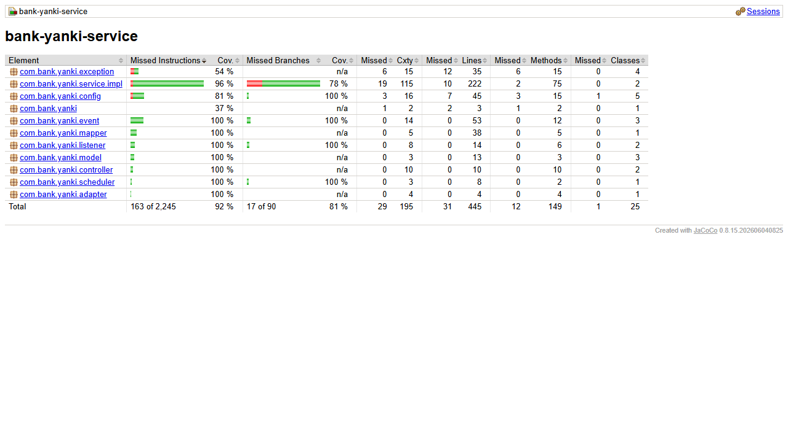

# bank-yanki-service

Microservicio nuevo de la Parte III: **monedero movil Yanki**. Permite enviar y
recibir pagos con solo el numero de celular. No requiere ser cliente del banco.

No llama a otros microservicios por REST: mantiene una copia local de las
tarjetas de debito (`debit_cards_replica`) y mueve saldos de cuentas pidiendo
operaciones por Kafka.

## Requisitos

- Java 17, Maven 3.9+
- MongoDB (base `bank_yanki`) y Kafka
- `bank-config-server` (8888) y `bank-eureka-server` (8761) arriba

## Variables de entorno

| Variable | Por defecto | Descripcion |
|---|---|---|
| `CONFIG_SERVER_URL` | `http://localhost:8888` | URL del Config Server |
| `KAFKA_BOOTSTRAP_SERVERS` | `localhost:9092` | Broker de Kafka |
| `MONGO_URI` | `mongodb://localhost:27017/bank_yanki` | Base de datos |
| `YANKI_PAYMENT_TIMEOUT` | `2m` | Tiempo maximo de un pago en `PENDING` |

Puerto 8088.

## Arranque

```bash
mvn clean package
mvn spring-boot:run
```

## Endpoints

| Metodo | URL | Exito |
|---|---|---|
| POST | `/yanki/wallets` | 201 |
| GET | `/yanki/wallets` (`?phoneNumber=`) | 200 |
| GET | `/yanki/wallets/{id}` | 200 |
| PUT | `/yanki/wallets/{id}` | 200 |
| DELETE | `/yanki/wallets/{id}` | 204 |
| PUT | `/yanki/wallets/{id}/debit-card` `{ "cardNumber" }` | 200 |
| DELETE | `/yanki/wallets/{id}/debit-card` | 200 |
| POST | `/yanki/payments` `{ fromPhoneNumber, toPhoneNumber, amount, description }` | **202** |
| GET | `/yanki/payments/{id}` | 200 |
| GET | `/yanki/payments` (`?phoneNumber=`) | 200 |

Especificacion: [`docs/openapi.yaml`](docs/openapi.yaml) · clases:
[`docs/class-diagram.md`](docs/class-diagram.md) · secuencias con y sin tarjeta:
[`bank-docs/docs/sequence-diagrams-part3.md`](../bank-docs/docs/sequence-diagrams-part3.md).

## Donde vive el saldo

- **Con tarjeta asociada**: en la **cuenta principal** de la tarjeta. Enviar
  descuenta de esa cuenta y recibir acredita en ella (`ACCOUNT_OPERATION_REQUESTED`).
  Solo la principal, no las demas cuentas de la tarjeta.
- **Sin tarjeta**: en el `balance` propio del monedero (empieza en 0; no hay
  recarga). Mientras tiene tarjeta, el `balance` propio no se usa.

Para asociar una tarjeta, debe existir en la copia local y estar `ACTIVE`.

## Flujo del pago (saga con compensacion)

1. Validacion: celulares distintos (409), ambos monederos existen (404), monto
   mayor que cero (400). Si el emisor usa saldo propio y no alcanza: 409.
2. Debito del emisor: con tarjeta, `WITHDRAWAL` y se espera el resultado; sin
   tarjeta, se descuenta su saldo.
3. Credito del receptor: con tarjeta, `DEPOSIT` y se espera; sin tarjeta, se
   suma a su saldo.
4. Si el credito falla (rechazo, receptor eliminado o tarjeta inactiva), se
   **compensa** el debito al emisor y el pago queda `FAILED`.
5. Al terminar se publica `YANKI_PAYMENT_COMPLETED` o `YANKI_PAYMENT_FAILED`.
6. Un `@Scheduled` (cada 30 s) marca `FAILED` los pagos con mas de 2 min en
   `PENDING`, compensando si el debito ya se hizo. Si un debito llega tarde a un
   pago ya vencido, se devuelve automaticamente.

El `POST` responde 202 con el estado actual: `PENDING` si espera a las cuentas, o
ya `COMPLETED` / `FAILED` cuando todo fue con saldos propios.

## Eventos

| Topic | Rol | Eventos |
|---|---|---|
| `bank.account.operation-requests` | publica | `ACCOUNT_OPERATION_REQUESTED` (`origin = YANKI`, `reference` = id del pago) |
| `bank.yanki.events` | publica | `YANKI_PAYMENT_COMPLETED`, `YANKI_PAYMENT_FAILED` |
| `bank.debit-card.events` | consume | copia `debit_cards_replica` |
| `bank.account.operation-results` | consume | avance de los pagos |

## Calidad

- 40 tests unitarios (Mockito): pagos con y sin tarjeta, saldo insuficiente,
  compensacion en saldo propio y por deposito, compensacion rechazada, pagos
  vencidos, debito tardio, monederos, listeners, publicador y controladores.
- Cobertura: 93.0% de lineas (95.5% en `service.impl`).


