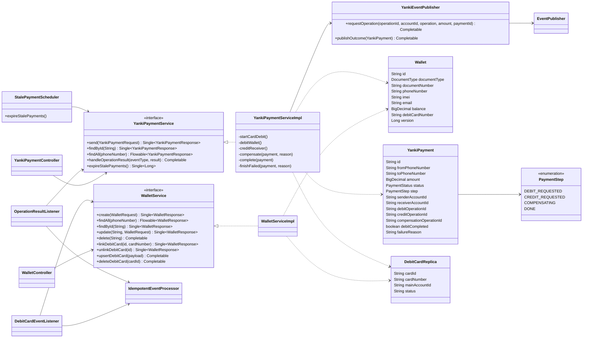

# Diagrama de clases - bank-yanki-service

Patrones: **Saga con compensacion** (orquestada por `YankiPaymentServiceImpl`,
pasos en `PaymentStep`), **Idempotent Consumer**, **Read model** (copia de
tarjetas), **Optimistic locking** (`@Version` en `Wallet`), **Adapter**,
**Builder**.
